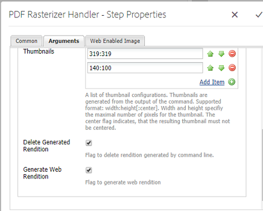

# Utilizza PDF Rasterizer {#using-pdf-rasterizer}

Quando si caricano file PDF o AI di grandi dimensioni e ad alta intensità di contenuto in [!DNL Adobe Experience Manager Assets], la libreria predefinita potrebbe non generare un output accurato. La libreria PDF Rasterizer di Adobe può generare un output più affidabile e accurato rispetto all&#39;output di una libreria predefinita. Adobe consiglia di utilizzare la libreria Rasterizer di PDF per i seguenti scenari:

Adobe consiglia di utilizzare la libreria Rasterizer di PDF per i seguenti elementi:

* File AI o PDF pesanti e ad alta intensità di contenuti.
* File AI e file PDF con miniature non generati per impostazione predefinita.
* File AI con colori Pantone Matching System (PMS).

Le miniature e le anteprime generate con PDF Rasterizer offrono una qualità migliore rispetto all&#39;output predefinito e forniscono pertanto un&#39;esperienza di visualizzazione coerente sui dispositivi. La libreria di Adobe PDF Rasterizer non supporta alcuna conversione di spazio colore. Viene sempre inviato a RGB indipendentemente dallo spazio colore del file sorgente.

1. Installa il pacchetto PDF Rasterizer nella distribuzione [!DNL Adobe Experience Manager] da [Distribuzione software](https://experience.adobe.com/#/downloads/content/software-distribution/en/aem.html?package=/content/software-distribution/en/details.html/content/dam/aem/public/adobe/packages/cq650/product/assets/aem-assets-pdf-rasterizer-pkg-4.6.zip).

   >[!NOTE]
   >
   >La libreria PDF Rasterizer è disponibile solo per Windows e Linux®.

1. Accedere alla console del flusso di lavoro [!DNL Assets] in `https://[aem_server]:[port]/workflow`. Apri [!UICONTROL Flusso di lavoro Aggiorna risorsa DAM].

1. Per evitare che vengano generate le miniature e le rappresentazioni Web per i file PDF e AI utilizzando i metodi predefiniti, effettuare le seguenti operazioni:

   * Apri il passaggio **[!UICONTROL Elabora miniature]** e aggiungi `application/pdf` o `application/postscript` nel campo **[!UICONTROL Ignora tipi MIME]** nella scheda **[!UICONTROL Miniature]**, in base alle esigenze.

   

   * Nella scheda **[!UICONTROL Immagine abilitata per il Web]**, aggiungi `application/pdf` o `application/postscript` in **[!UICONTROL Elenco di salto]** in base alle tue esigenze.

   

1. Apri il passaggio **[!UICONTROL Rasterizza rappresentazione anteprima immagine PDF/AI]** e rimuovi il tipo MIME per il quale vuoi saltare la generazione predefinita di rappresentazioni immagine di anteprima. Rimuovere ad esempio il tipo MIME `application/pdf`, `application/postscript` o `application/illustrator` dall&#39;elenco **[!UICONTROL Tipi MIME]**.

   

1. Trascina il passaggio **[!UICONTROL Gestore rasterizzatore PDF]** dal pannello laterale a sotto il passaggio **[!UICONTROL Elabora miniature]**.
1. Configura i seguenti argomenti per il passaggio **[!UICONTROL Gestore rasterizzatore PDF]**:

   * Tipi MIME: `application/pdf` o `application/postscript`
   * Comandi: `PDFRasterizer -d -s 1280 -t PNG -i ${file}`
   * Aggiungi dimensioni miniature: 319:319, 140:100, 48:48. Se necessario, aggiungi una configurazione di miniature personalizzata.

   Gli argomenti della riga di comando per il comando `PDFRasterizer` possono includere quanto segue:

   * `-d`: contrassegno per consentire il rendering uniforme di testo, grafica vettoriale e immagini. Crea immagini di qualità superiore. Tuttavia, l&#39;inclusione di questo parametro determina un rallentamento dell&#39;esecuzione del comando e un aumento delle dimensioni delle immagini.

   * `-s`: dimensione immagine massima (altezza o larghezza). Viene convertito in DPI per ogni pagina. Se le pagine sono di dimensioni diverse, ogni pagina può potenzialmente ridimensionarsi in base a quantità diverse. L&#39;impostazione predefinita è la dimensione effettiva della pagina.

   * `-t`: tipo di immagine di output. I tipi validi sono JPEG, PNG, GIF e BMP. Il valore predefinito è JPEG.

   * `-i`: percorso per PDF di input. È un parametro obbligatorio.

   * `-h`: Guida

1. Per eliminare le rappresentazioni intermedie, selezionare **[!UICONTROL Elimina rappresentazione generata]**.
1. Per consentire a PDF Rasterizer di generare rappresentazioni Web, selezionare **[!UICONTROL Genera rappresentazione Web]**.

   

1. Specificare le impostazioni nella scheda **[!UICONTROL Immagine abilitata per il Web]**.

   

1. Salva il flusso di lavoro.
1. Per consentire a PDF Rasterizer di elaborare le pagine PDF con le librerie PDF, apri il modello **[!UICONTROL DAM Process Subasset]** dalla console [!UICONTROL Workflow].
1. Dal pannello laterale, trascina il passaggio Gestore rasterizzatore di PDF sotto il passaggio **[!UICONTROL Crea rappresentazione di immagini abilitate per il web]**.
1. Configura i seguenti argomenti per il passaggio **[!UICONTROL Gestore rasterizzatore PDF]**:

   * Tipi MIME: `application/pdf` o `application/postscript`
   * Comandi: `PDFRasterizer -d -s 1280 -t PNG -i ${file}`
   * Aggiungi dimensioni miniature: `319:319`, `140:100`, `48:48`. Aggiungi la configurazione di miniature personalizzata come richiesto.

   Gli argomenti della riga di comando per il comando `PDFRasterizer` possono includere quanto segue:

   * `-d`: contrassegno per consentire il rendering uniforme di testo, grafica vettoriale e immagini. Crea immagini di qualità superiore. Tuttavia, l&#39;inclusione di questo parametro determina un rallentamento dell&#39;esecuzione del comando e un aumento delle dimensioni delle immagini.

   * `-s`: dimensione immagine massima (altezza o larghezza). Viene convertito in DPI per ogni pagina. Se le pagine sono di dimensioni diverse, ogni pagina può potenzialmente ridimensionarsi in base a quantità diverse. L&#39;impostazione predefinita è la dimensione effettiva della pagina.

   * `-t`: tipo di immagine di output. I tipi validi sono JPEG, PNG, GIF e BMP. Il valore predefinito è JPEG.

   * `-i`: percorso per PDF di input. È un parametro obbligatorio.

   * `-h`: Guida

1. Per eliminare le rappresentazioni intermedie, selezionare **[!UICONTROL Elimina rappresentazione generata]**.
1. Per consentire a PDF Rasterizer di generare rappresentazioni Web, selezionare **[!UICONTROL Genera rappresentazione Web]**.

   

1. Specificare le impostazioni nella scheda **[!UICONTROL Immagine abilitata per il Web]**.

   

1. Salva il flusso di lavoro.
1. Caricare un file PDF o AI in [!DNL Experience Manager Assets]. PDF Rasterizer genera le miniature e le rappresentazioni web del file.
