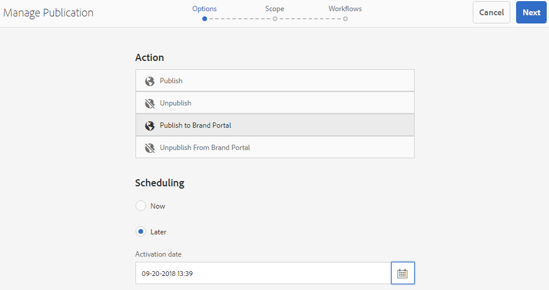
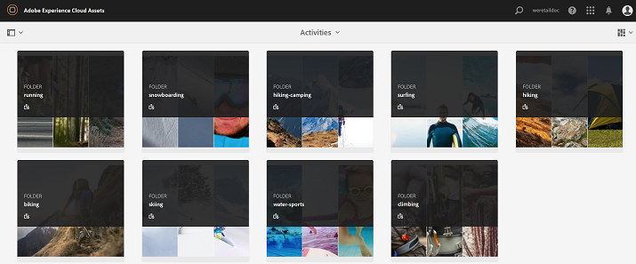

# Pubblicare risorse in Brand Portal {#publish-assets-to-brand-portal}

| Versione | Collegamento articolo |
| -------- | ---------------------------- |
| AEM as a Cloud Service | [Fai clic qui](https://experienceleague.adobe.com/docs/experience-manager-cloud-service/content/assets/brand-portal/publish-to-brand-portal.html?lang=it) |
| AEM 6.5 | Questo articolo |

In qualità di amministratore di Adobe Experience Manager (AEM) Assets, puoi pubblicare risorse e cartelle nell’istanza di AEM Assets Brand Portal (o pianificare il flusso di lavoro di pubblicazione in una data/ora successiva) per la tua organizzazione. Devi però prima configurare AEM Assets con Brand Portal. Per ulteriori dettagli, consulta [Configurare AEM Assets con Brand Portal](/help/assets/configure-aem-assets-with-brand-portal.md).

Una volta completata la replica, puoi pubblicare risorse, cartelle e raccolte in Brand Portal. Per pubblicare le risorse in Brand Portal, effettua le seguenti operazioni:

>[!NOTE]
>
>Adobe consiglia di scaglionare la pubblicazione, eseguendola preferibilmente nelle ore non di picco, in modo che AEM Author non utilizzi troppe risorse.

1. Dalla console di Assets, seleziona le risorse o la cartella da pubblicare e fai clic sull&#39;opzione **[!UICONTROL Pubblicazione rapida]** nella barra degli strumenti.

   In alternativa, seleziona le risorse da pubblicare su Brand Portal.

   

1. Per pubblicare le risorse in Brand Portal, sono disponibili le due opzioni seguenti:
   * [Pubblicare immediatamente le risorse](#publish-to-bp-now)
   * [Pubblicare le risorse in un secondo momento](#publish-to-bp-now)

## Pubblicare subito le risorse {#publish-to-bp-now}

Per pubblicare le risorse selezionate su Brand Portal, effettua una delle seguenti operazioni:

* Dalla barra degli strumenti, seleziona **[!UICONTROL Pubblicazione rapida]**. Quindi dal menu, seleziona **[!UICONTROL Pubblica su Brand Portal]**.

* Dalla barra degli strumenti, seleziona **[!UICONTROL Gestisci pubblicazione]**.

  1. Quindi dall&#39;**[!UICONTROL Azione]** selezionare **[!UICONTROL Pubblica in Brand Portal]** e da **[!UICONTROL Pianificazione]** selezionare **[!UICONTROL Ora]**. Fai clic su **[!UICONTROL Avanti]**.

  2. All&#39;interno di **[!UICONTROL Ambito]**, confermare la selezione e fare clic su **[!UICONTROL Pubblica in Brand Portal]**.

Viene visualizzato un messaggio per informare che le risorse sono state accodate per la pubblicazione su Brand Portal. Per visualizzare le risorse pubblicate, accedi all’interfaccia di Brand Portal.

## Pubblicare le risorse in un secondo momento {#publish-to-bp-later}

Per pianificare la pubblicazione delle risorse su Brand Portal in una data o un’ora successiva:

1. Dopo aver selezionato le risorse o le cartelle da pubblicare, seleziona **[!UICONTROL Gestisci pubblicazione]** dalla barra degli strumenti nella parte superiore.

1. Nella pagina **[!UICONTROL Gestisci pubblicazione]**, seleziona **[!UICONTROL Pubblica su Brand Portal]** da **[!UICONTROL Azione]** e seleziona **[!UICONTROL Più tardi]** da **[!UICONTROL Pianificazione]**.

   

1. Seleziona un valore per **[!UICONTROL Data di attivazione]** e specifica l’ora. Fai clic su **[!UICONTROL Avanti]**.

1. Seleziona un valore per **Data di attivazione** e specifica l’ora. Fai clic su **Avanti**.

1. Specifica un valore per **[!UICONTROL Titolo flusso di lavoro]** in **[!UICONTROL Flussi di lavoro]**. Fai clic su **[!UICONTROL Pubblica più tardi]**.

   

Ora accedi a Brand Portal per verificare se le risorse pubblicate sono disponibili sull’interfaccia di Brand Portal.

## Visualizza file o cartella pubblicata in Brand Portal {#view-published-file-folder}

1. Accedi all’interfaccia di Brand Portal per visualizzare le risorse pubblicate (a seconda della data o dell’ora pianificata).

   

1. Passa alla vista a elenco  per visualizzare lo stato di pubblicazione corrente della risorsa.

<!--2. On the [Asset Reports page](#https://experienceleague.adobe.com/en/docs/experience-manager-cloud-service/content/assets/admin/asset-reports), you can see the current state of the report job, for example, Success, Failed, Queued, or Scheduled.-->

