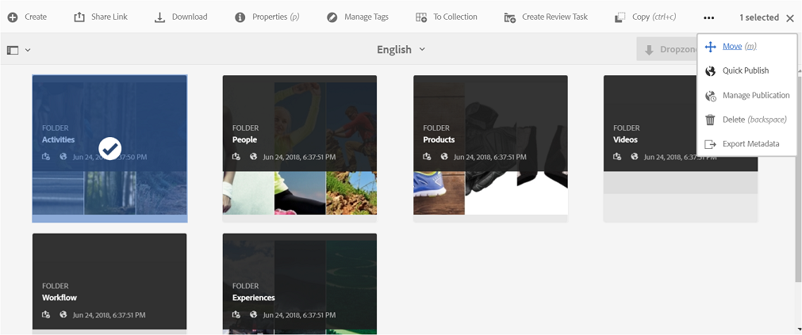
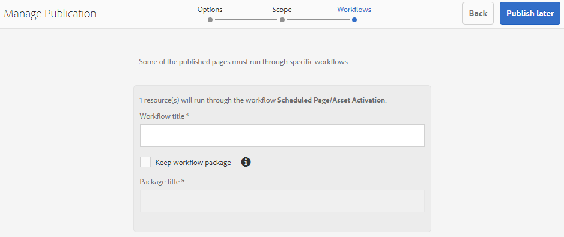
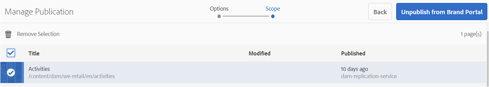
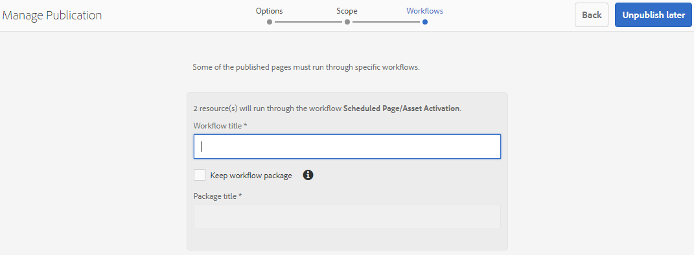

# Pubblicare cartelle in Brand Portal{#publish-folders-to-brand-portal}

In qualità di amministratore di Adobe Experience Manager (AEM) Assets, puoi pubblicare risorse e cartelle nell’istanza di AEM Assets Brand Portal (o pianificare il flusso di lavoro di pubblicazione in una data/ora successiva) per la tua organizzazione. Tuttavia, devi prima integrare AEM Assets con Brand Portal. Per ulteriori dettagli, consulta [Configurare AEM Assets con Brand Portal](/help/assets/configure-aem-assets-with-brand-portal.md).

Dopo aver pubblicato una risorsa o una cartella, questa è disponibile per gli utenti di Brand Portal.

Se apporti successive modifiche alla risorsa o alla cartella originale in AEM Assets, le modifiche non vengono applicate in Brand Portal fino a quando non ripubblichi la risorsa o la cartella. Questa funzione garantisce che le modifiche in corso d’opera non siano disponibili in Brand Portal. Solo le modifiche approvate pubblicate da un amministratore sono infatti disponibili in Brand Portal.

## Pubblicare cartelle in Brand Portal {#publish-folders-to-brand-portal-1}

1. Dall&#39;interfaccia di AEM Assets, passa il cursore del mouse sulla cartella desiderata e seleziona l&#39;opzione **Pubblica** dalle azioni rapide.

   In alternativa, seleziona la cartella desiderata e segui i passaggi successivi.

   

1. **Pubblicare subito le cartelle**

   Per pubblicare le cartelle selezionate su Brand Portal, effettua una delle seguenti operazioni:

   * Dalla barra degli strumenti, seleziona **Pubblicazione rapida**. Quindi dal menu, seleziona **Pubblica su Brand Portal**.

   * Dalla barra degli strumenti, seleziona **Gestisci pubblicazione**.

   1. Da **Azione** selezionare **Pubblica su Brand Portal**, da **Pianificazione** selezionare **Ora** e fare clic su **Avanti.**
   1. Conferma la selezione in **Ambito** e fai clic su **Pubblica su Brand Portal**.

   Viene visualizzato un messaggio per informare che la cartella è stata accodata per la pubblicazione su Brand Portal. Accedi all’interfaccia di Brand Portal per visualizzare la cartella pubblicata.

   **Pubblicare le cartelle in un secondo momento**

   Per pianificare il flusso di lavoro di pubblicazione su Brand Portal per le cartelle di risorse in una data o in un’ora successiva:

   1. Dopo aver selezionato le risorse o le cartelle da pubblicare, seleziona **Gestisci pubblicazione** dalla barra degli strumenti nella parte superiore.
   1. Da **Azione** selezionare **Pubblica su Brand Portal**, da **Pianificazione** selezionare **Più tardi**.

      

   1. Seleziona un valore per **Data di attivazione** e specifica l’ora. Fai clic su **Avanti**.
   1. Conferma la selezione in **Ambito**. Fai clic su **Avanti**.
   1. Specifica un titolo del flusso di lavoro in **Flussi di lavoro**. Fai clic su **Pubblica più tardi**.

      

## Annullare la pubblicazione di cartelle da Brand Portal {#unpublish-folders-from-brand-portal}

Per rimuovere una cartella di risorse pubblicata in Brand Portal, annullane la pubblicazione dall’istanza di AEM Author. Dopo l’annullamento della pubblicazione della cartella originale, la relativa copia non sarà più disponibile per gli utenti di Brand Portal.

Puoi annullare rapidamente la pubblicazione delle cartelle su Brand Portal o pianificarla per una data e un’ora successive. Per annullare la pubblicazione delle cartelle di risorse su Brand Portal:

1. Dall’interfaccia di AEM Assets nell’istanza di AEM Author, seleziona la cartella di cui vuoi annullare la pubblicazione.

   

1. Dalla barra degli strumenti, fai clic su **Gestisci pubblicazione**.

1. **Annulla pubblicazione da Brand Portal**

   Per annullare rapidamente la pubblicazione della cartella desiderata da Brand Portal:

   1. Dalla barra degli strumenti, seleziona **Gestisci pubblicazione**.
   1. Da **Azione** seleziona **Annulla pubblicazione da Brand Portal**, da **Pianificazione** seleziona **Ora** e fai clic su **Avanti.**
   1. Conferma la selezione in **Ambito** e fai clic su **Annulla pubblicazione su Brand Portal**.

   

   **Annulla pubblicazione da Brand Portal più tardi**

   Per pianificare la pubblicazione di una cartella da Brand Portal a una data e un’ora successive:

   1. Dalla barra degli strumenti, seleziona **Gestisci pubblicazione**.
   1. Da **Azione** selezionare **Annulla pubblicazione da Brand Portal** e da **Pianificazione** selezionare **Più tardi**.
   1. Seleziona un valore per **Data di attivazione** e specifica l’ora. Fai clic su **Avanti**.
   1. Conferma la selezione in **Ambito** e fai clic su **Avanti**.
   1. Specifica un valore per **Titolo flusso di lavoro** in **Flussi di lavoro**. Fai clic su **Annulla pubblicazione più tardi.**

      

>[!NOTE]
>
>La procedura per pubblicare/annullare la pubblicazione di una risorsa in/da Brand Portal è simile alla procedura di correzione per una cartella.
