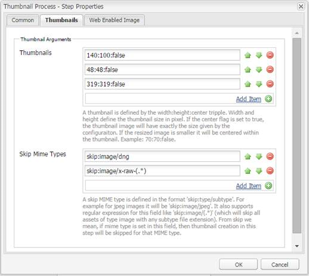

# Elabora immagini con [!DNL Adobe Camera Raw] {#camera-raw-support}

È possibile abilitare il supporto di [!DNL Adobe Camera Raw] per elaborare i formati di file non elaborati, ad esempio CR2, NEF e RAF, ed eseguire il rendering delle immagini in formato JPEG. La funzionalità è supportata in [!DNL Adobe Experience Manager Assets] utilizzando il [pacchetto Camera Raw](https://experience.adobe.com/#/downloads/content/software-distribution/en/aem.html?package=/content/software-distribution/en/details.html/content/dam/aem/public/adobe/packages/aem630/product/assets/aem-assets-cameraraw-pkg) disponibile in Software Distribution.

>[!NOTE]
>
>Questa funzionalità supporta solo le rappresentazioni di JPEG. È supportato su Windows a 64 bit, Mac OS e RHEL 7.x.

Per abilitare il supporto di [!DNL Camera Raw] in [!DNL Experience Manager Assets], eseguire la procedura seguente:

1. Scarica il [[!DNL Camera Raw] pacchetto](https://experience.adobe.com/#/downloads/content/software-distribution/en/aem.html?package=/content/software-distribution/en/details.html/content/dam/aem/public/adobe/packages/cq650/product/assets/aem-assets-cameraraw-pkg-1.4.8.zip) da [!DNL Software Distribution].
1. Accedi a `https://[aem_server]:[port]/workflow`. Apri il flusso di lavoro **[!UICONTROL Risorsa di aggiornamento DAM]**.
1. Modifica il passaggio **[!UICONTROL Elabora miniature]**.
1. Fornisci la seguente configurazione nella scheda **[!UICONTROL Miniature]**:

   * **[!UICONTROL Miniature]**: `140:100:false, 48:48:false, 319:319:false`
   * **[!UICONTROL Ignora tipi MIME]**: `skip:image/dng, skip:image/x-raw-(.*)`

   

1. Nella scheda **[!UICONTROL Immagine abilitata per il Web]**, nel campo **[!UICONTROL Elenco di salto]**, specificare `audio/mpeg, video/(.*), image/dng, image/x-raw-(.*)`.

   

1. Dal pannello laterale, aggiungi il passaggio **[!UICONTROL Gestore Camera Raw/DNG]** sotto il passaggio **[!UICONTROL Elabora miniature]**.
1. Nel passaggio **[!UICONTROL Gestore Camera Raw/DNG]**, aggiungi la seguente configurazione nella scheda **[!UICONTROL Argomenti]**:

   * **[!UICONTROL Tipi MIME]**: `image/dng` e `image/x-raw-(.*)`
   * **[!UICONTROL Comando]**:

     * `DAM_Raw_Converter ${directory}/${filename} ${directory} cq5dam.web.1280.1280.jpeg 1280 1280`
     * `DAM_Raw_Converter ${directory}/${filename} ${directory} cq5dam.thumbnail.319.319.jpeg 319 319`
     * `DAM_Raw_Converter ${directory}/${filename} ${directory} cq5dam.thumbnail.140.100.jpeg 140 100`
     * `DAM_Raw_Converter ${directory}/${filename} ${directory} cq5dam.thumbnail.48.48.jpeg 48 48`

   

1. Fai clic su **[!UICONTROL Salva]**.

>[!NOTE]
>
>Assicurati che la configurazione precedente sia la stessa della configurazione del **[!UICONTROL Esempio di risorsa di aggiornamento DAM con Camera Raw e del passaggio di gestione DNG]**.

Ora è possibile importare i file Camera Raw in Assets. Dopo aver installato il pacchetto Camera Raw e configurato il flusso di lavoro richiesto, nell&#39;elenco dei riquadri laterali viene visualizzata l&#39;opzione **[!UICONTROL Regola immagine]**.

*Figura: opzioni nel riquadro laterale.*

*Figura: utilizzare l&#39;opzione per apportare modifiche leggere alle immagini.*

Dopo aver salvato le modifiche in un&#39;immagine [!DNL Camera Raw], viene generata una nuova rappresentazione `AdjustedPreview.jpg` per l&#39;immagine. Per gli altri tipi di immagine ad eccezione di [!DNL Camera Raw], le modifiche vengono applicate a tutte le rappresentazioni.

## Best practice, problemi noti e limitazioni {#best-practices}

La funzionalità presenta le seguenti limitazioni:

* Questa funzionalità supporta solo le rappresentazioni di JPEG. È supportato in Windows 64 Bit, Mac OS e RHEL 7.x.
* Il writeback dei metadati non è supportato per i formati RAW e DNG.
* La libreria [!DNL Camera Raw] presenta limitazioni sul totale di pixel che può elaborare alla volta. Attualmente, può elaborare un massimo di 65000 pixel sul lato lungo di un file o 512 MP, indipendentemente dai criteri incontrati per primi.
