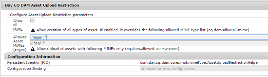

# Configurare le restrizioni di caricamento delle risorse {#configuring-asset-upload-restrictions}

È possibile configurare [!DNL Adobe Experience Manager Assets] per limitare il tipo di risorse che gli utenti possono caricare. Aiuta a prevenire caricamenti accidentali di formato indesiderato e file dannosi. Il servizio `Day CQ DAM Asset Upload Restriction` consente di controllare il tipo di file che gli utenti possono caricare. Per impostazione predefinita, [!DNL Assets] consente agli utenti di caricare risorse di tutti i tipi MIME. Tuttavia, puoi configurare il servizio in modo da limitare gli utenti al caricamento solo di file di tipi MIME specifici.

1. Apri la console Web di Configuration Manager. Accedi a `https://[aem_server]:[port]/system/console/configMgr`.
1. Apri il servizio **[!UICONTROL Day CQ DAM Asset Upload Restriction]** in modalità Modifica. Per impostazione predefinita, è selezionata l&#39;opzione **Consenti tutti i tipi MIME**, che consente agli utenti di caricare file di tutti i tipi MIME.

   

1. Per limitare gli utenti al caricamento solo di file di determinati tipi MIME, deselezionare l&#39;opzione **[!UICONTROL Consenti tutti i tipi MIME]** e specificare i tipi MIME consentiti nei campi **[!UICONTROL Tipi MIME di risorse consentiti (regex)]** utilizzando espressioni regolari.

   

1. Fai clic su **[!UICONTROL Salva]** per salvare le modifiche. Se specifichi stringhe MIME per i tipi MIME consentiti, l’operazione di caricamento non riuscirà per qualsiasi risorsa il cui tipo MIME non corrisponde alle stringhe MIME configurate in questi campi.
