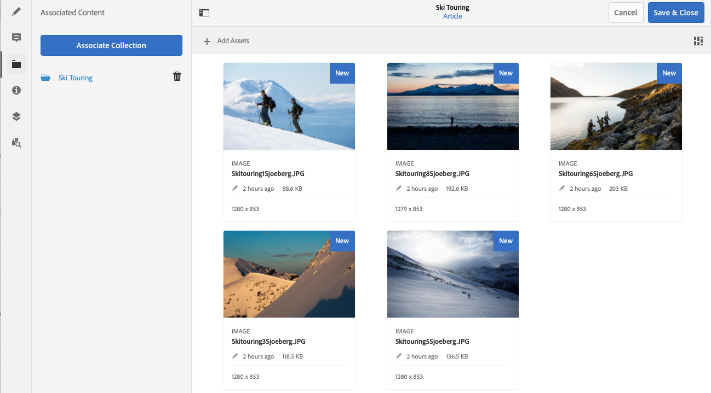

# Contenuto associato{#associated-content}

La funzione di contenuto associato AEM fornisce la connessione in modo che le risorse possano (facoltativamente) essere utilizzate con il frammento quando viene aggiunto a una pagina di contenuto. Ciò offre flessibilità per la distribuzione di contenuti headless [fornendo una serie di risorse a cui accedere quando si utilizza il frammento di contenuto su una pagina](/help/sites-authoring/content-fragments.md#using-associated-content), contribuendo anche a ridurre il tempo necessario per cercare la risorsa appropriata. Qualsiasi contenuto associato può essere configurato utilizzando l’editor di frammenti di contenuto.

## Aggiunta di contenuto associato {#adding-associated-content}

>[!NOTE]
>
>Esistono diversi metodi per aggiungere [risorse visive (ad esempio immagini)](/help/assets/content-fragments/content-fragments.md#fragments-with-visual-assets) al frammento e/o alla pagina.

Per creare l&#39;associazione, devi innanzitutto [aggiungere le risorse multimediali a una raccolta](/help/assets/manage-collections.md). Una volta fatto questo è possibile:

1. Apri il frammento e seleziona **Contenuto associato** dal pannello laterale.

   

1. A seconda che siano già state associate o meno delle raccolte, seleziona una delle seguenti opzioni:

   * **Associa contenuto**: questa sarà la prima raccolta associata
   * **Associa raccolta** - raccolte associate già configurate

1. Seleziona la raccolta richiesta.

   Facoltativamente, è possibile aggiungere il frammento stesso alla raccolta selezionata, in modo da favorire il tracciamento.

   

1. Conferma (con **Seleziona**). La raccolta verrà elencata come associata.

   

## Modifica del contenuto associato {#editing-associated-content}

Una volta associata una raccolta puoi:

* **Rimuovere** l’associazione.
* **Aggiungere risorse** a una raccolta.
* Selezionare una risorsa per ulteriori azioni.
* Modificare la risorsa.
