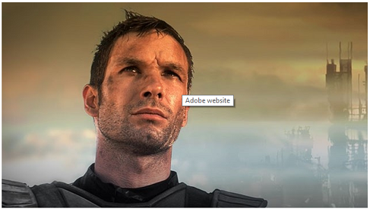

# Aggiungere mappe immagine {#adding-image-maps}

Le mappe immagine consentono di aggiungere una o più aree con collegamenti ipertestuali che funzionano come gli altri collegamenti ipertestuali.

1. Per aprire **[!UICONTROL Editor immagini locale]**, eseguire una delle operazioni seguenti:

   * Utilizzando Azioni rapide, fai clic su **[!UICONTROL Modifica]** che viene visualizzato su una risorsa nella visualizzazione **[!UICONTROL Scheda]**. Nella vista a elenco, seleziona la risorsa e fai clic sull&#39;opzione **[!UICONTROL Modifica]** nella barra degli strumenti.

     >[!NOTE]
     >
     >Azioni rapide non disponibile nella visualizzazione **[!UICONTROL Elenco]**.

   * Nella visualizzazione **[!UICONTROL Scheda]** o **[!UICONTROL Elenco]**, seleziona la risorsa e fai clic su **[!UICONTROL Modifica]** sulla barra degli strumenti.
   * Fai clic su **[!UICONTROL Modifica]** nella pagina della risorsa.

1. Per inserire una mappa immagine, fare clic su **[!UICONTROL Mappa lancio]**  nella barra degli strumenti.
1. Selezionare la forma della mappa immagine. Il punto attivo della forma selezionata viene posizionato sull&#39;immagine.

   

1. Fare clic sull&#39;area sensibile e immettere l&#39;URL e il testo Alt. Dall&#39;elenco **[!UICONTROL Target]**, specificare la posizione in cui si desidera visualizzare la mappa immagine, ad esempio la stessa scheda, una nuova scheda o un iFrame. Ad esempio, immetti `https://www.adobe.com` come URL, `Adobe website` come testo Alt e specifica **[!UICONTROL Nuova scheda]** dall&#39;elenco **[!UICONTROL Target]** per aprire la mappa immagine in una nuova scheda.

   

1. Fai clic su **[!UICONTROL Conferma]** e quindi su **[!UICONTROL Fine]**  nella barra degli strumenti per salvare le modifiche.

   Per eliminare la mappa immagine, fai clic sull&#39;area sensibile e fai clic su **[!UICONTROL Elimina]** .

1. Per visualizzare la mappa immagine, passa alla pagina dei dettagli della risorsa e passa il cursore sull’immagine.

   

   Se l&#39;opzione Dynamic Media è abilitata, accedi all&#39;editor risorse e fai clic su **[!UICONTROL Mappa]** per visualizzare tutte le mappe immagine applicate.
