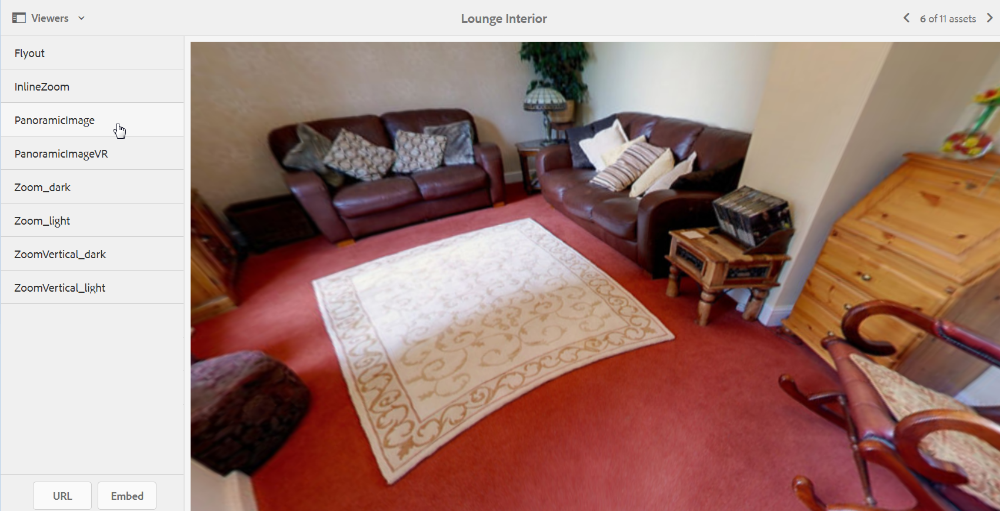

# Immagini panoramiche{#panoramic-images}

Questa sezione descrive come lavorare con il visualizzatore Immagine panoramica per riprodurre immagini panoramiche sferiche per un&#39;esperienza di visualizzazione a 360 gradi immersiva di una stanza, una proprietà, una posizione o un paesaggio.

Vedi anche [Gestione predefiniti visualizzatore](/help/assets/managing-viewer-presets.md).

## Carica le risorse da utilizzare con il visualizzatore immagini panoramiche {#uploading-assets-for-use-with-the-panoramic-image-viewer}

Affinché una risorsa caricata possa essere considerata un’immagine panoramica sferica da utilizzare con il visualizzatore immagini panoramiche, è necessario che la risorsa presenti uno o entrambi i seguenti elementi:

* Proporzioni pari a 2.
Puoi modificare l’impostazione predefinita delle proporzioni pari a 2 in CRXDE Lite nei seguenti modi:
  `/conf/global/settings/cloudconfigs/dmscene7/jcr:content`

* Taggato con le parole chiave `equirectangular` o `spherical` e `panorama` o `spherical` e `panoramic`. Vedi [Utilizzo dei tag](/help/sites-authoring/tags.md).

Sia le proporzioni che i criteri delle parole chiave si applicano alle risorse panoramiche della pagina dettagli risorsa e al componente WCM `Panoramic Media`.

Per caricare le risorse da utilizzare con il visualizzatore immagini panoramiche, consulta [Caricare Assets](/help/assets/manage-assets.md#uploading-assets).

## Configurare Dynamic Media Classic {#configuring-dynamic-media-classic-scene}

Affinché il visualizzatore Immagine panoramica funzioni correttamente in Adobe Experience Manager, sincronizza i predefiniti del visualizzatore Immagine panoramica con i metadati specifici di Dynamic Media Classic e Dynamic Media Classic in modo che i predefiniti del visualizzatore vengano aggiornati in JCR. Per eseguire questa sincronizzazione, configura Dynamic Media Classic come segue:

1. Apri l&#39;[applicazione desktop Dynamic Media Classic](https://experienceleague.adobe.com/docs/dynamic-media-classic/using/getting-started/signing-out.html?lang=it#getting-started), quindi accedi al tuo account.

1. Nell&#39;angolo superiore destro della pagina, selezionare **[!UICONTROL Configurazione]** > **[!UICONTROL Configurazione applicazione]** > **[!UICONTROL Impostazione pubblicazione]** > **[!UICONTROL Server immagini]**.
1. Nella pagina Pubblicazione su Image Server, dal menu a discesa **[!UICONTROL Contesto di pubblicazione]** nella parte superiore, seleziona **[!UICONTROL Image Server]**.

1. Nella stessa pagina di pubblicazione del server immagini, individua l&#39;intestazione **[!UICONTROL Attributi richiesta]**.
1. Nell&#39;intestazione Attributi richiesta individuare **[!UICONTROL Limite dimensioni immagine di risposta]**. Quindi, nei campi Larghezza e Altezza associati, aumenta la dimensione immagine massima consentita per le immagini panoramiche.

   Dynamic Media Classic ha un limite di 25.000.000 di pixel. Le dimensioni massime consentite per le immagini con un rapporto di formato 2:1 sono 7000 x 3500. Tuttavia, per i tipici schermi desktop, è sufficiente la risoluzione di 4096 x 2048 pixel.

   >[!NOTE]
   >
   >Sono supportate solo le immagini che rientrano nelle dimensioni massime consentite. Le richieste di immagini che superano il limite di dimensioni generano una risposta 403.

1. Nell’intestazione Attributi della richiesta, effettua le seguenti operazioni:

   * Impostare la modalità di offuscamento della richiesta su **[!UICONTROL Disabilitato]**.
   * Impostare la modalità di blocco delle richieste su **[!UICONTROL Disabilitato]**.

   Queste impostazioni sono necessarie per utilizzare il componente WCM `Panoramic Media` in Experience Manager.

1. Nella parte inferiore della pagina Pubblica su Image Server, sul lato sinistro, selezionare **[!UICONTROL Salva]**.

1. Nell&#39;angolo inferiore destro selezionare **[!UICONTROL Chiudi]**.

### Risoluzione dei problemi del componente WCM per elementi multimediali panoramici {#troubleshooting-the-panoramic-media-wcm-component}

Se hai rilasciato un’immagine nel componente Elemento multimediale panoramico in WCM e il segnaposto del componente è compresso, risolvi i problemi seguenti:

* Se si verifica un errore 403 Forbidden, la causa potrebbe essere l&#39;eccessiva dimensione dell&#39;immagine richiesta. Rivedi le impostazioni del **[!UICONTROL Limite dimensioni immagine di risposta]** in [Configura Dynamic Media Classic](/help/assets/panoramic-images.md#configuring-dynamic-media-classic-scene).

* Per un &quot;Blocco non valido&quot; sulla risorsa o un &quot;Errore di analisi&quot; visualizzato sulla pagina, seleziona Request Obfuscation Mode (Modalità di offuscamento richiesta) e Request Locking Mode (Modalità di blocco richiesta) per assicurarti che siano disabilitati.
* Per un errore nell’area di lavoro contaminata, imposta un percorso file definizione set regole e annulla validità CTN per le richieste precedenti per la risorsa immagine.
* Se dopo una richiesta di immagine il livello di qualità dell&#39;immagine diventa basso e il dimensionamento supera il limite supportato, verificare che l&#39;impostazione **[!UICONTROL Attributi codifica JPEG > Qualità]** non sia vuota. Un&#39;impostazione tipica per il campo **[!UICONTROL Qualità]** è `95`. L&#39;impostazione è disponibile nella pagina di pubblicazione del server immagini. Per accedere alla pagina, vedere [Configurare Dynamic Media Classic](/help/assets/panoramic-images.md#configuring-dynamic-media-classic-scene).

## Anteprima immagini panoramiche {#previewing-panoramic-images}

Vedi [Anteprima Assets](/help/assets/previewing-assets.md).

## Pubblica immagini panoramiche {#publishing-panoramic-images}

Consulta [Pubblicare Assets](/help/assets/publishing-dynamicmedia-assets.md).
