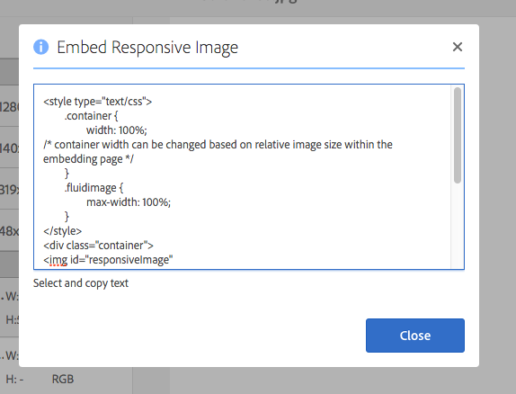

# Distribuzione di immagini ottimizzate per un sito reattivo {#delivering-optimized-images-for-a-responsive-site}

Utilizza la funzione Codice reattivo per condividere il codice per il servizio reattivo con il tuo sviluppatore web. Il codice responsive (**[!UICONTROL RESS]**) viene copiato negli Appunti in modo da poterlo condividere con lo sviluppatore Web.

Questa funzione è utile se il sito web si trova su un WCM di terze parti. Tuttavia, se il tuo sito web si trova su Adobe Experience Manager, un server di immagini fuori sede esegue il rendering dell’immagine e la fornisce alla pagina web.

Vedere anche [Incorporare il Visualizzatore video in una pagina Web](embed-code.md).

Vedi anche [Collegare gli URL all&#39;applicazione Web](linking-urls-to-yourwebapplication.md).

**Per distribuire immagini ottimizzate per un sito reattivo:**

1. Passa all&#39;immagine per la quale vuoi fornire il codice reattivo e seleziona **[!UICONTROL Rappresentazioni]** nel menu a discesa.

   

1. Seleziona un predefinito per immagini reattive. Vengono visualizzati i pulsanti **[!UICONTROL URL]** e **[!UICONTROL RESS]**.

   

   >[!NOTE]
   >
   >Per poter rendere disponibili i pulsanti **[!UICONTROL URL]** o **[!UICONTROL RESS]**, la risorsa selezionata *e* il predefinito per immagini o il predefinito visualizzatore devono essere pubblicati.
   >
   >Dynamic Media: la modalità ibrida richiede la pubblicazione di predefiniti immagine; Dynamic Media: la modalità Scene7 pubblica automaticamente i predefiniti immagine.

1. Selezionare **[!UICONTROL RESS]**.

   

1. Nella finestra di dialogo **[!UICONTROL Incorpora immagine reattiva]**, seleziona e copia il testo del codice reattivo e incollalo nel sito Web per accedere alla risorsa reattiva.
1. Modifica i punti di interruzione predefiniti nel codice di incorporamento in modo che corrispondano ai punti di interruzione del sito web dinamico, direttamente nel codice. Inoltre, verifica le diverse risoluzioni dell’immagine distribuite in diversi punti di interruzione della pagina.

## Utilizza HTTP/2 per distribuire le risorse Dynamic Media {#using-http-to-delivery-your-dynamic-media-assets}

HTTP/2 è il nuovo protocollo web aggiornato che migliora il modo in cui browser e server comunicano. Consente di trasferire più rapidamente le informazioni e di ridurre la potenza di elaborazione necessaria. La distribuzione delle risorse Dynamic Media è supportata tramite HTTP/2, che fornisce tempi di risposta e caricamento migliori.

Consulta [Distribuzione HTTP2 dei contenuti](http2.md) per informazioni complete su come iniziare a utilizzare HTTP/2 con l&#39;account Dynamic Media.
