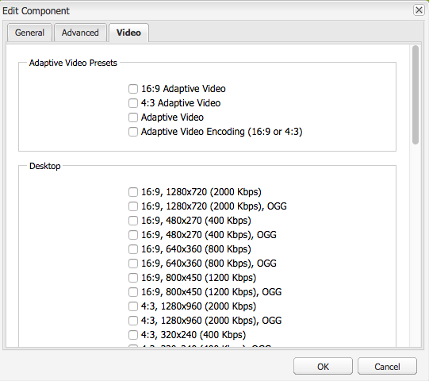
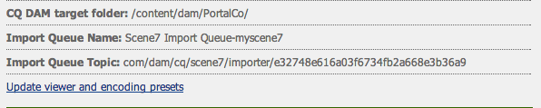
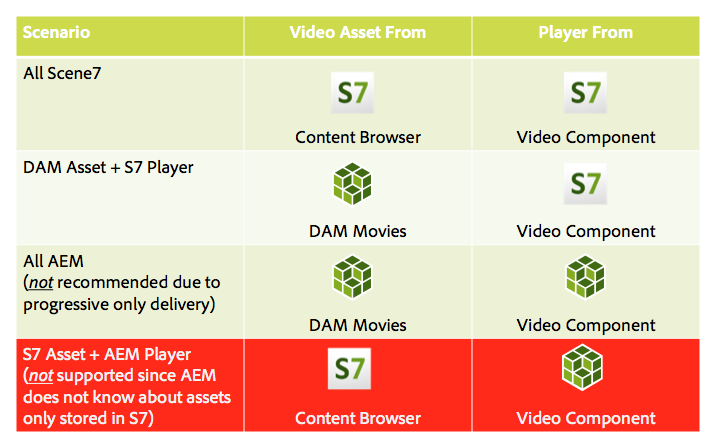
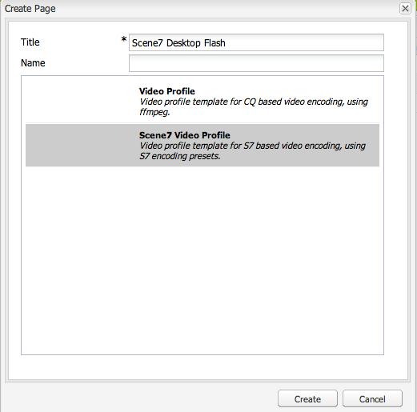
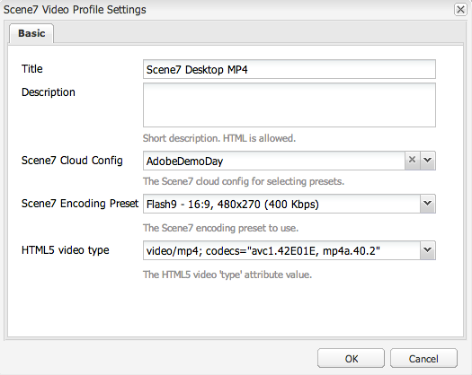

# Video {#video}

Adobe Experience Manager Assets offre la gestione centralizzata delle risorse video, in cui puoi caricare i video direttamente in Assets per la codifica automatica in Dynamic Media Classic e accedere ai video Dynamic Media Classic direttamente da Assets per l’authoring delle pagine.

L&#39;integrazione video Dynamic Media Classic estende la portata del video ottimizzato a tutti gli schermi (rilevamento automatico di dispositivi e larghezza di banda).

* Il componente **[!UICONTROL Video Scene7]** esegue automaticamente il rilevamento del dispositivo e della larghezza di banda per riprodurre il formato e la qualità video corretti su desktop, tablet e dispositivi mobili.
* Assets: puoi includere set di video adattivi anziché solo singole risorse video. Un set di video adattivi contiene tutte le rappresentazioni video necessarie per riprodurre il video in modo fluido su più schermi. Un set video adattivo raggruppa le versioni dello stesso video che sono codificate in diversi formati e bit rate, ad esempio 400 kbps, 800 kbps e 1000 kbps. Utilizzi un set video adattivo, insieme al componente video S7, per lo streaming video adattivo su più schermi, inclusi desktop, iOS, Android™, BlackBerry® e dispositivi mobili Windows.
<!-- See [Scene7 documentation about adaptive video sets for more information](https://help.adobe.com/it_IT/scene7/using/WS53492AE1-6029-45d8-BF80-F4B5CF33EB08.html). -->

## Informazioni su FFMPEG e Dynamic Media Classic {#about-ffmpeg-and-scene}

Il processo di codifica video predefinito si basa sull’utilizzo dell’integrazione basata su FFMPEG con i profili video. Pertanto, il flusso di lavoro di acquisizione DAM preconfigurato contiene i due passaggi di flusso di lavoro basati su ffmpeg seguenti:

* Miniature FFMPEG
* Codifica FFMPEG

L’abilitazione e la configurazione dell’integrazione di Dynamic Media Classic non rimuovono o disattivano automaticamente questi due passaggi del flusso di lavoro dal flusso di lavoro di acquisizione DAM predefinito. Se in Adobe Experience Manager utilizzi già la codifica video basata su FFMPEG, è probabile che negli ambienti di authoring sia installato FFMPEG. In questo caso, un nuovo video acquisito utilizzando DAM verrebbe codificato due volte: una volta dal codificatore FFMPEG e una volta dall’integrazione Dynamic Media Classic.

Se hai configurato la codifica video basata su FFMPEG in Experience Manager e hai installato FFMPEG, Adobe consiglia di rimuovere i due flussi di lavoro FFMPEG dai flussi di lavoro di acquisizione DAM.

## Formati supportati {#supported-formats}

Il componente Video Scene7 supporta i seguenti formati:

* F4V H.264
* MP4 H.264

## Decidi dove caricare il video {#deciding-where-to-upload-your-video}

La scelta del percorso in cui caricare le risorse video dipende da quanto segue:

* È necessario un flusso di lavoro per la risorsa video?
* È necessario il controllo della versione per la risorsa video?

Se la risposta è &quot;sì&quot; a una o entrambe queste domande, carica il video direttamente in Adobe DAM. Se la risposta è &quot;no&quot; a entrambe le domande, carica il video direttamente in Dynamic Media Classic. Il flusso di lavoro per ogni scenario è descritto nella sezione seguente.

### Se carichi il video direttamente in Adobe DAM {#if-you-are-uploading-your-video-directly-to-adobe-dam}

Se hai bisogno di un flusso di lavoro o di un controllo delle versioni per le risorse, carica prima in Adobe DAM. Di seguito è riportato il flusso di lavoro consigliato:

1. Carica la risorsa video in Adobe DAM e codifica e pubblica automaticamente in Dynamic Media Classic.
1. In Experience Manager, accedi alle risorse video in WCM nella scheda **[!UICONTROL Filmati]** di Content Finder.
1. Autore con il componente **[!UICONTROL Video Scene7]** o **[!UICONTROL Video Foundation]**.

### Se stai caricando il tuo video su Dynamic Media Classic {#if-you-are-uploading-your-video-to-scene}

Se non hai bisogno di un flusso di lavoro o di un controllo delle versioni per le risorse, carica le risorse in Scene7. Di seguito è riportato il flusso di lavoro consigliato:

1. In Dynamic Media Classic, [imposta il caricamento e la codifica pianificati dell&#39;FTP in Scene7 (sistema automatizzato)](https://experienceleague.adobe.com/docs/dynamic-media-classic/using/upload-publish/uploading-files.html?lang=it#upload-files-using-via-ftp).
1. In Experience Manager, accedi alle risorse video in WCM nella scheda **[!UICONTROL Scene7]** di Content Finder.
1. Autore con il componente **[!UICONTROL Video Scene7]**.

## Configurare l’integrazione con Scene7 Video {#configuring-integration-with-scene-video}

1. In **[!UICONTROL Cloud Services]**, passa alla configurazione **[!UICONTROL Scene7]** e seleziona **[!UICONTROL Modifica]**.
1. Selezionare la scheda **[!UICONTROL Video]**.

   

   >[!NOTE]
   >
   >La scheda **[!UICONTROL Video]** non viene visualizzata se la pagina non dispone di una configurazione cloud.

1. Seleziona il profilo di codifica video adattivo, un profilo di codifica video singolo predefinito o un profilo di codifica video personalizzato.

   >[!NOTE]
   >
   >Per ulteriori informazioni sul significato dei predefiniti video, consulta la [documentazione di Dynamic Media Classic](https://experienceleague.adobe.com/docs/dynamic-media-classic/using/setup/application-setup.html?lang=it#video-presets-for-encoding-video-files).
   >
   >Adobe consiglia di selezionare entrambi i set di video adattivi durante la configurazione dei predefiniti universali o di selezionare l&#39;opzione **[!UICONTROL Codifica video adattivo]**.

1. I profili di codifica selezionati vengono applicati automaticamente a tutti i video caricati nella cartella di destinazione CQ DAM configurata per questa configurazione cloud Scene7. Puoi impostare più configurazioni cloud Scene7 con diverse cartelle di destinazione per applicare diversi profili di codifica, in base alle esigenze.

## Aggiorna visualizzatore e predefiniti di codifica {#updating-viewer-and-encoding-presets}

Per aggiornare il visualizzatore e i predefiniti di codifica per il video perché i predefiniti sono stati aggiornati in Scene7, passa alla configurazione Scene7 in Configurazione cloud e seleziona **[!UICONTROL Aggiorna il visualizzatore e i predefiniti di codifica]**.

## Carica il video sorgente principale in Scene7 da Adobe DAM {#uploading-your-master-video}

1. Passa alla cartella di destinazione CQ DAM in cui hai impostato la configurazione cloud con i profili di codifica Scene7.
1. Seleziona **[!UICONTROL Carica]** per caricare il video di origine principale. Il caricamento e la codifica video sono stati completati dopo il completamento del flusso di lavoro [!UICONTROL Risorsa di aggiornamento DAM] e dopo il segno di spunta **[!UICONTROL Pubblica in Scene7]**.

   >[!NOTE]
   >
   >La generazione delle miniature video richiede del tempo.

   Trascinare il video sorgente principale DAM sul componente video consente di accedere a *tutte* le rappresentazioni proxy con codifica Scene7 per la consegna.

## Componente video di base e componente video di Scene7 {#foundation-video-component-versus-scene-video-component}

Quando si utilizza Experience Manager, è possibile accedere sia al componente Video disponibile in Sites che al componente video di Scene7. Questi componenti non sono intercambiabili.

Il componente video Scene7 funziona solo per i video Scene7. Il componente base funziona con i video memorizzati da Experience Manager (utilizzando ffmpeg) e Scene7.

La seguente matrice spiega quando utilizzare quale componente:

>[!NOTE]
>
>Il componente video S7 utilizza come predefinito il profilo video universale. Tuttavia, puoi ottenere il lettore video basato su HTML5 per l’utilizzo da parte di Experience Manager. In Scene7, copia il codice da incorporare del lettore video HTML5 pronto all’uso e inseriscilo nella pagina Experience Manager.

## Componente video Experience Manager {#aem-video-component}

Anche se l’utilizzo del componente video Scene7 è consigliato per la visualizzazione dei video Scene7, in questa sezione viene descritto l’utilizzo dei video Scene7 con il componente video di base in Experience Manager, per ragioni di completezza.

### Confronto tra video Experience Manager e video Scene7 {#aem-video-and-scene-video-comparison}

La tabella seguente fornisce un confronto ad alto livello delle funzionalità supportate tra il componente Video di Experience Manager Foundation e il componente Video di Scene7:

|   | Video di Experience Manager Foundation | Video Scene7 |
|---|---|---|
| Approccio | Primo approccio HTML5. Flash viene utilizzato solo per il fallback non HTML5. | Flash sulla maggior parte dei desktop. HTML5 viene utilizzato per dispositivi mobili e tablet. |
| Distribuzione | Progressivo | Streaming adattivo |
| Tracciamento | Sì | Sì |
| Estensibilità | Sì | No |
| Video mobile | Sì | Sì |

### Configurazione {#setting-up}

#### Creare profili video {#creating-video-profiles}

Le varie codifiche video vengono create in base ai predefiniti di codifica S7 selezionati nella configurazione cloud S7. Affinché il componente video di base possa utilizzarli, è necessario creare un profilo video per ogni predefinito di codifica S7 selezionato. Questo metodo consente al componente video di selezionare le relative rappresentazioni DAM.

>[!NOTE]
>
>Per poter pubblicare, è necessario attivare nuovi profili video e le relative modifiche.

1. In Experience Manager, seleziona **[!UICONTROL Strumenti]** > **[!UICONTROL Console di configurazione]**.
1. Nella **[!UICONTROL Console di configurazione]**, passa a **[!UICONTROL Strumenti]** > **[!UICONTROL DAM]** > **[!UICONTROL Profili video]** nella struttura di navigazione.
1. Crea un profilo video S7. In **[!UICONTROL Nuovo]**. , selezionare **[!UICONTROL Crea pagina]**, quindi selezionare il modello Profilo video Scene7. Assegna un nome alla nuova pagina del profilo video e seleziona **[!UICONTROL Crea]**.

   

1. Modifica il nuovo profilo video. Seleziona prima la configurazione cloud. Quindi seleziona lo stesso predefinito di codifica selezionato nella configurazione cloud.

   

   | Proprietà | Descrizione |
   |---|---|
   | Configurazione cloud Scene7 | Configurazione cloud da utilizzare per i predefiniti di codifica. |
   | Predefinito di codifica Scene7 | Predefinito di codifica con cui mappare questo profilo video. |
   | Tipo video HTML5 | Questa proprietà consente di impostare il valore della proprietà type dell&#39;elemento sorgente video HTML5. Queste informazioni non vengono fornite dai predefiniti di codifica S7, ma sono necessarie per il corretto rendering dei video tramite l’elemento video HTML5. Viene fornito un elenco per i formati comuni, ma può essere sovrascritto per altri formati. |

   Ripeti questo passaggio per tutti i predefiniti di codifica selezionati nella configurazione cloud che desideri utilizzare nel componente video.

#### Configurare la progettazione {#configuring-design}

Il componente **[!UICONTROL Video Foundation]** deve sapere quali profili video utilizzare per creare l&#39;elenco di origini video. Apri la finestra di dialogo di progettazione dei componenti video e configura la progettazione dei componenti per l’utilizzo dei nuovi profili video.

>[!NOTE]
>
>Se utilizzi il componente **[!UICONTROL Video Foundation]** in una pagina mobile, ripeti questi passaggi nella progettazione della pagina mobile.

>[!NOTE]
>
>Le modifiche apportate al progetto richiedono l’attivazione del progetto per avere effetto al momento della pubblicazione.

1. Apri la finestra di dialogo per progettazione del componente **[!UICONTROL Foundation Video]** e passa alla scheda **[!UICONTROL Profili]**. Quindi elimina i profili predefiniti e aggiungi i nuovi profili video S7. L&#39;ordine dell&#39;elenco dei profili nella finestra di dialogo di progettazione definisce l&#39;ordine dell&#39;elemento sorgenti video durante il rendering.
1. Per i browser che non supportano HTML5, il componente video consente di configurare un fallback Flash. Apri la finestra di dialogo di progettazione dei componenti video e passa alla scheda **[!UICONTROL Flash]**. Configurate le impostazioni di Flash Player e assegnate un profilo di fallback per Flash Player.

#### Elenco di controllo {#checklist}

1. Crea una configurazione cloud S7. Assicurati che i predefiniti di codifica video siano impostati e che l’importazione sia in esecuzione.
1. Crea un profilo video S7 per ogni predefinito di codifica video selezionato nella configurazione cloud.
1. È necessario attivare i profili video.
1. Configura la progettazione del componente **[!UICONTROL Video Foundation]** nella pagina.
1. Attiva la progettazione al termine delle modifiche.
