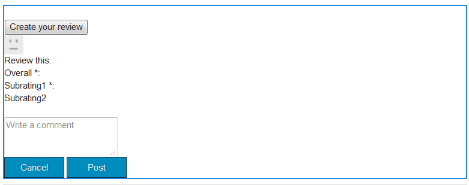
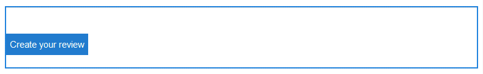

# Nozioni di base sui componenti community {#communities-components-basics}

## Panoramica {#overview}

La sezione sull’authoring della documentazione descrive l’aggiunta di funzioni di Communities ai siti AEM in modalità di modifica autore e descrive le configurazioni dei componenti.

I componenti possono essere esaminati utilizzando un&#39;istanza di AEM e la [guida interattiva dei componenti della community](components-guide.md).

## Accesso ai componenti delle community {#accessing-communities-components}

Durante l’authoring del contenuto di una pagina, se il modello sottostante consente di modificare la struttura della pagina, è possibile abilitare componenti non ancora disponibili nel browser Componenti come parte della progettazione del sito.

Vedi l&#39;elenco in [Componenti community disponibili](author-communities.md#available-communities-components).

>[!NOTE]
>
>Per informazioni generali sull&#39;authoring, consulta la [guida rapida all&#39;authoring delle pagine](../../help/sites-authoring/qg-page-authoring.md).
>
>Se non conosci AEM, consulta la documentazione sulle [operazioni di base](../../help/sites-authoring/basic-handling.md).

### Entrata in modalità progettazione {#entering-design-mode}

Se un componente **Communities** non viene trovato nel browser dei componenti (barra laterale), sarà necessario immettere `Design Mode` per aggiungere altri componenti di Communities. [Potrebbe essere necessario aggiungere anche le librerie lato client richieste](#required-clientlibs) (clientlibs).

Per informazioni dettagliate, vedere [Configurazione dei componenti in modalità progettazione](../../help/sites-authoring/default-components-designmode.md).

Di seguito sono riportate le immagini relative alla selezione di alcuni componenti di Communities e alla loro visualizzazione nel browser Componenti:

I componenti selezionati sono ora disponibili nel browser Componenti:

## Clientlibs richieste {#required-clientlibs}

[Le librerie lato client](../../help/sites-developing/clientlibs.md) (clientlibs) sono necessarie per il corretto funzionamento (JavaScript) e lo stile (CSS) di un componente.

Quando si aggiunge un componente Communities a una pagina, se il risultato è un errore o un aspetto imprevisto, la prima cosa da provare è aggiungere le clientlibs richieste per il componente Communities. Per informazioni dettagliate, vedere [Clientlibs for Communities Components](clientlibs.md).

### Esempio: recensioni inizialmente inserite senza librerie client... {#example-initially-placed-reviews-without-client-libraries}

### ... E con le librerie client {#and-with-client-libraries}

## Assegnazione tag {#tagging}

Molte funzioni di Communities possono essere configurate per consentire ai membri di assegnare tag al contenuto immesso (pubblicato) nell’ambiente di pubblicazione.

Se l&#39;assegnazione tag è consentita, la configurazione del sito community può essere impostata in modo da limitare gli spazi dei nomi presentati ai membri nell&#39;ambiente di pubblicazione. Visualizza la [console Siti community](sites-console.md#tagging).

Funzionalità che consentono l&#39;assegnazione tag: [blog](blog-feature.md), [calendario](calendar.md), [libreria file](file-library.md), [forum](forum.md)

Funzionalità che utilizzano i tag: [search](search.md), [social tag cloud](tagcloud.md)

Per informazioni sull&#39;authoring:

* [Utilizzo dei tag](../../help/sites-authoring/tags.md)

Per informazioni amministrative:

* Creazione degli spazi dei nomi dei tag (tassonomia): [Amministrazione dei tag](../../help/sites-administering/tags.md)
* Configurazione del sito community: vedi [ASSEGNAZIONE TAG](sites-console.md#tagging)
* [Assegnazione di tag ai contenuti generati dagli utenti](../../help/sites-authoring/tags.md)

Per informazioni per gli sviluppatori:

* [Framework di assegnazione tag AEM](../../help/sites-developing/framework.md)
* [Nozioni di base sull’assegnazione tag](tag.md)
