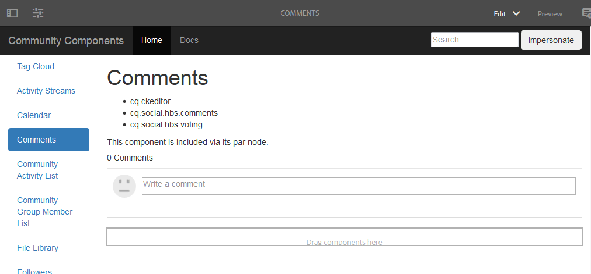

# Pagina Crea commenti {#create-comments-page}

**[⇐ Componente Commenti Di Sovrapposizione](overlay-comments.md) [Crea Nodi ⇒](overlay-create-nodes.md)**

## Pagina Commenti {#comments-page}

La [guida dei componenti della community](components-guide.md) consente di provare facilmente la sovrapposizione del componente Commenti.

Visualizza la pagina nell’istanza di authoring:

* [http://localhost:4502/editor.html/content/community-components/en/comments.html](http://localhost:4502/editor.html/content/community-components/en/comments.html)

**[⇐ Componente Commenti Di Sovrapposizione](overlay-comments.md) [Crea Nodi ⇒](overlay-create-nodes.md)**
