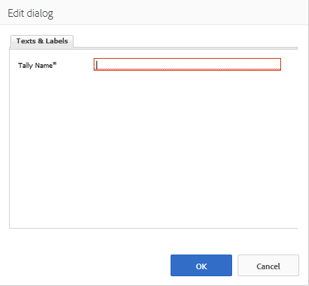

# Utilizzo delle valutazioni {#using-ratings}

Il componente `Rating` viene utilizzato da solo o con altre funzionalità di Communities. Questo componente consente ai membri della community con accesso esterno di esprimere le proprie opinioni attraverso la valutazione del contenuto.

## Aggiunta di una valutazione a una pagina {#adding-a-rating-to-a-page}

Per aggiungere un componente `Rating` a una pagina in modalità di creazione, individuare il componente `Communities / Rating` e trascinarlo in una pagina, ad esempio una posizione relativa alla caratteristica che i membri devono valutare.

Per informazioni necessarie, visitare [Nozioni di base sui componenti delle community](basics.md).

Quando sono incluse le [librerie lato client richieste](rating-basics.md#essentials-for-client-side), il componente `Rating` viene visualizzato in questo modo.

## Configurazione della valutazione {#configuring-rating}

Selezionare il componente `Rating` inserito in modo da poter accedere e selezionare l&#39;icona `Configure` che apre la finestra di dialogo per modifica.

Nella scheda **[!UICONTROL Testi ed etichette]**, specifica l&#39;identificatore interno per la valutazione.

**[!UICONTROL Nome conteggio]**
(*Obbligatorio*) Nome semplice per `Rating` che identifica in modo univoco questa istanza. Deve essere un nome di nodo valido per l’archivio.

## Esperienza visitatore del sito {#site-visitor-experience}

### Membri {#members}

È consentita una sola valutazione per membro. L&#39;iscritto può cambiare la propria valutazione in qualsiasi momento.

### Anonimo {#anonymous}

La pubblicazione anonima di una valutazione non è supportata. I visitatori del sito devono registrarsi (diventare membri) e accedere per partecipare.

## Informazioni aggiuntive {#additional-information}

Ulteriori informazioni sono disponibili nella pagina [Elementi di valutazione](rating-basics.md) per sviluppatori.
