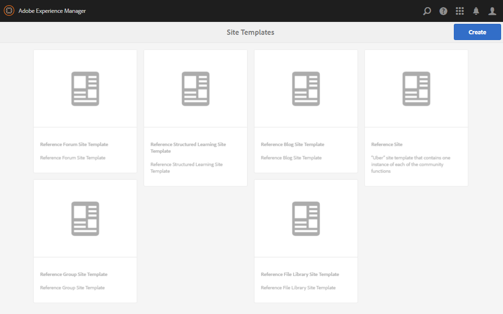
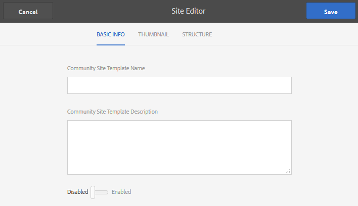
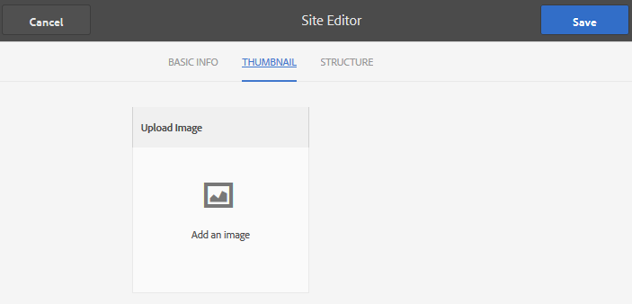
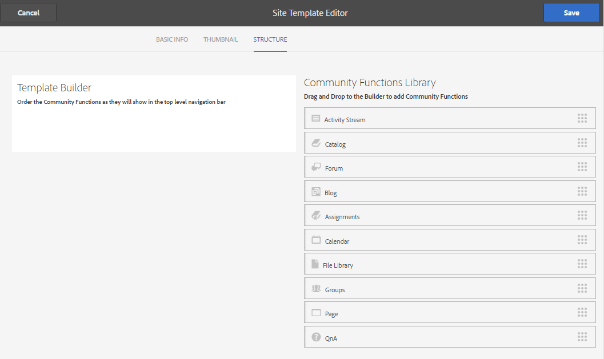
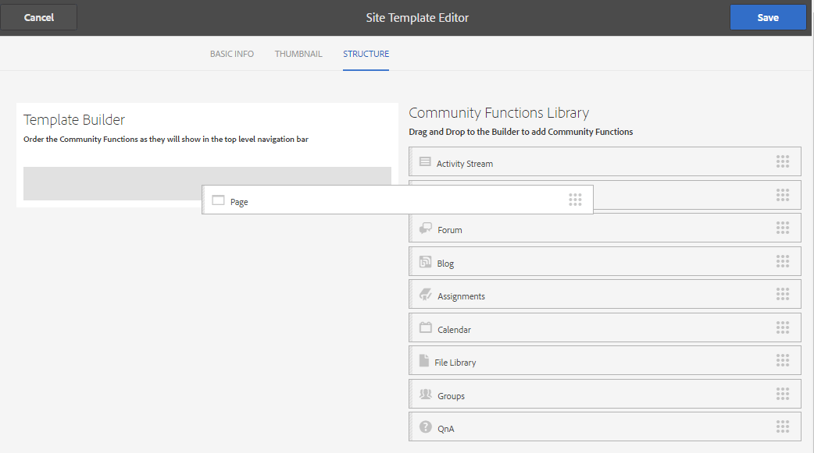
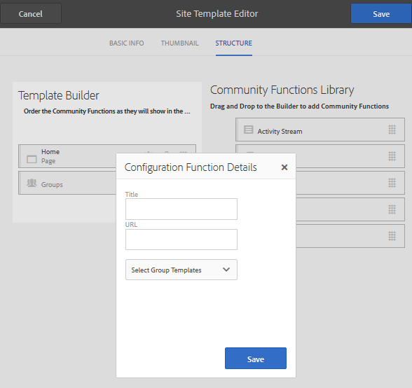

# Modelli per siti {#site-templates}

La console Modelli sito è simile alla console [Modelli gruppo](tools-groups.md), che si concentra su funzioni di interesse per i gruppi della community.

>[!NOTE]
>
>Le console per la creazione di [siti community](sites-console.md), [modelli di siti community](sites.md), [modelli di gruppi community](tools-groups.md) e [funzioni community](functions.md) sono utilizzabili solo nell&#39;ambiente di authoring.

## Console modelli sito {#site-templates-console}

Nell’ambiente di authoring, per raggiungere la console dei siti della community:

* Dalla navigazione globale: **[!UICONTROL Strumenti > Community > Modelli del sito]**

Questa console visualizza i modelli da cui è possibile creare un [sito community](sites-console.md) e consente la creazione di nuovi modelli di sito.

## Crea modello per siti {#create-site-template}

Per iniziare a creare un modello di sito, selezionare `Create`.

Viene aperto il pannello Editor sito, che contiene tre pannelli secondari:

### Informazioni di base {#basic-info}

Nel pannello Informazioni di base, vengono configurati un nome, una descrizione e se il modello è abilitato o disabilitato:

* **[!UICONTROL Nome modello per sito community]**

  ID del nome del modello.

* **[!UICONTROL Descrizione modello per sito community]**

  Descrizione del modello.

* **[!UICONTROL Disabilitato/Abilitato]**

  Un interruttore che controlla se il modello è referenziabile.

### Miniatura {#thumbnail}

(Facoltativo) Fai clic sull&#39;icona Carica immagine per visualizzare una miniatura con il nome e la descrizione ai creatori dei siti della community.

### Struttura {#structure}

Per aggiungere funzioni di community, trascinare il puntatore del mouse dal lato destro a quello sinistro nell&#39;ordine in cui devono essere visualizzati i collegamenti del menu del sito. Gli stili vengono applicati al modello durante la creazione del sito.

Ad esempio, se desideri una home page, trascina la funzione Page dalla libreria e rilasciala nel generatore di modelli. Questo determina l’apertura della finestra di dialogo per la configurazione della pagina. Per informazioni sulle finestre di dialogo di configurazione, vedere la [console delle funzioni](functions.md).

Continuare a trascinare le altre funzioni community desiderate per un sito community basato su questo modello.

La funzione page fornisce una pagina vuota. La funzione Gruppi consente di creare un sito di gruppo (sottocommunity) all&#39;interno del sito community.

>[!CAUTION]
>
>La funzione Groups non deve essere la prima né l&#39;unica *funzione nella struttura del sito.*
>
>Qualsiasi altra funzione, ad esempio la funzione [page](functions.md#page-function), deve essere inclusa ed elencata per prima.

### Modelli per gruppi per funzione Gruppi {#group-templates-for-groups-function}

Quando si include una funzione Gruppi nel modello di sito, la configurazione richiede la specifica delle scelte del modello di gruppo consentite quando viene creato un nuovo gruppo nell’ambiente di pubblicazione.

>[!CAUTION]
>
>La funzione Groups non deve essere la prima né l&#39;unica *funzione nella struttura del sito.*

Selezionando due o più modelli per gruppi community, l&#39;amministratore del gruppo può scegliere quando creare effettivamente un gruppo nella community.

## Modifica modello sito {#edit-site-template}

Quando si visualizzano i modelli di sito nella [console Modelli sito](#site-templates-console) principale, è possibile selezionare un modello di sito esistente da modificare.

Questo processo fornisce gli stessi pannelli di [creazione di un modello di sito](#create-site-template).
