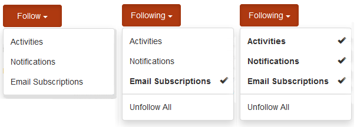
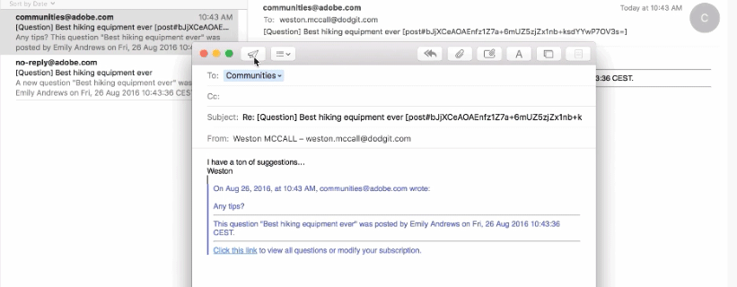
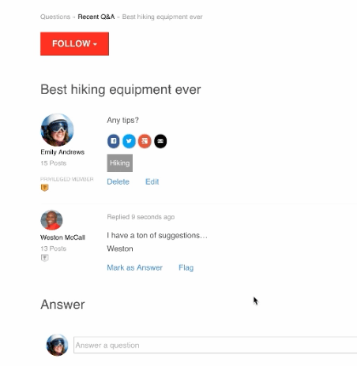

# Iscrizioni alle community {#communities-subscriptions}

## Panoramica {#overview}

A partire da Communities [FP1](deploy-communities.md#latestfeaturepack), i membri della community possono interagire con la community tramite e-mail utilizzando una funzione definita come abbonamenti.

Gli abbonamenti sono simili alle [notifiche](notifications.md) in quanto i membri possono sottoscrivere quando seguono articoli di blog, argomenti dei forum o domande di qualità.

Ciò che distingue gli abbonamenti dalle notifiche è:

* I membri non possono sottoscrivere un abbonamento quando seguono altri membri.
* L&#39;unica azione che i membri possono eseguire è selezionare `Email Subscriptions` quando si esegue l&#39;operazione seguente.
* Una volta configurata la risposta e-mail, i membri possono pubblicare efficacemente il contenuto semplicemente rispondendo all’e-mail ricevuta.

### Requisiti {#requirements}

**Configura e-mail**

Affinché gli abbonamenti siano funzionali, è necessario configurare l’indirizzo e-mail e consentire ai membri di rispondere per e-mail.

Per istruzioni sulla configurazione dell&#39;e-mail, vedere [Configurazione dell&#39;e-mail](email.md).

**Abilita sottoscrizioni e segui**

I componenti devono essere configurati per abilitare le sottoscrizioni *e* dopo. Le funzionalità che consentono gli abbonamenti sono [blog](blog-feature.md), [forum](forum.md) e [QnA](working-with-qna.md).

## Abbonamenti da Segui {#subscriptions-from-following}

Il pulsante **Segui** consente di seguire le voci come attività, abbonamenti e/o notifiche. Ogni volta che il pulsante **Segui** è selezionato, è possibile attivare o disattivare una selezione.

Se è selezionato un metodo qualsiasi di seguire, il testo del pulsante diventa **Segue**. Per comodità, è possibile selezionare `Unfollow All` per disattivare tutti i metodi.

Il pulsante **Segui** includerà l&#39;opzione `Email Subscriptions` solo quando un forum, un QnA o un blog è configurato per abilitare gli abbonamenti e-mail. Questo pulsante viene visualizzato:

* Nella pagina delle funzioni principale del forum, del QnA o del blog abilitato, verrà inviata un’e-mail per tutte le attività che rientrano in tale funzione.

* Per una voce specifica, ad esempio un argomento forum, una domanda di controllo qualità o un articolo di blog Invierà un’e-mail quando c’è attività per quella voce specifica.

## Rispondi per e-mail {#reply-by-email}

Quando l&#39;indirizzo e-mail è [configurato per rispondere tramite e-mail](email.md#configure-polling-importer), il membro che si è iscritto riceverà un&#39;e-mail con il contenuto pubblicato e un collegamento al contenuto online.

Se rispondono all&#39;e-mail, il contenuto immesso nella risposta verrà visualizzato come contenuto in linea.

Il tempo necessario per la pubblicazione di una risposta è controllato dall&#39;[intervallo di aggiornamento dell&#39;importazione polling](email.md#configure-polling-importer).

