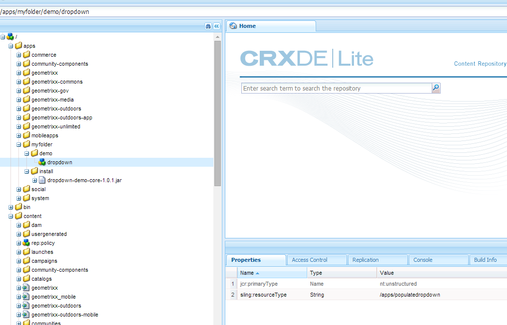
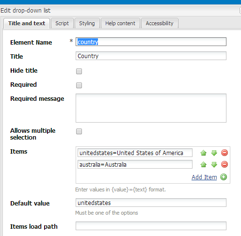
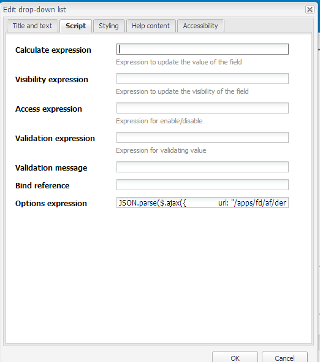
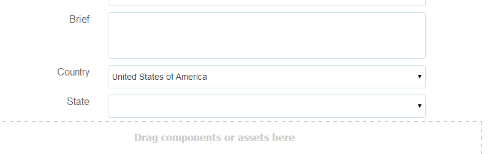

# Compilazione dinamica di elenchi a discesa {#dynamically-populating-drop-down-lists}

## Prerequisiti {#prerequisites}

* [Creazione di bundle OSGi](https://helpx.adobe.com/experience-manager/using/creating-osgi-bundles-digital-marketing.html)
* [Sviluppo di componenti AEM](/help/sites-developing/components.md)
* [Creazione di un modulo adattivo](../../forms/using/creating-adaptive-form.md)
* [Authoring di un modulo adattivo](../../forms/using/introduction-forms-authoring.md)

## Procedura per compilare dinamicamente gli elenchi a discesa {#procedure-to-dynamically-populate-drop-down-lists}

Considera uno scenario in cui desideri popolare l&#39;elenco a discesa **Stato** in base a un valore selezionato nell&#39;elenco a discesa **Paese**. Se si seleziona Australia nell&#39;elenco a discesa **Paese**, nell&#39;elenco a discesa **Stato** verranno visualizzati gli stati in Australia. La procedura seguente descrive come eseguire questa attività.

1. Crea un progetto con i seguenti moduli:

   * Il bundle che contiene la logica per compilare il menu a discesa, che in questo caso è un servlet.
   * Il contenuto, che incorpora il file .jar e dispone di una risorsa a discesa. Il servlet punta a questa risorsa.

1. Scrivi un servlet in base al parametro della richiesta Country, che restituisce un array contenente i nomi degli stati all’interno del paese.

   ```java
   @Component(metatype = false)
   @Service(value = Servlet.class)
   @Properties({
           @Property(name = "sling.servlet.resourceTypes", value = "/apps/populatedropdown"),
           @Property(name = "sling.servlet.methods", value = {"GET", "POST"}),
           @Property(name = "service.description", value = "Populate states dropdown based on country value")
   })
   public class DropDownPopulator extends SlingAllMethodsServlet {
       private Logger logger = LoggerFactory.getLogger(DropDownPopulator.class);
   
       protected void doPost(SlingHttpServletRequest request,
                             final SlingHttpServletResponse response)
               throws ServletException, IOException {
           response.setHeader("Access-Control-Allow-Origin", "*");
           response.setContentType("application/json");
           response.setCharacterEncoding("UTF-8");
           try {
               String US_STATES[] = {"0=Alabama",
                       "1=Alaska",
                       "2=Arizona",
                       "3=Arkansas",
                       "4=California",
                       "5=Colorado",
                       "6=Connecticut",
                       "7=Delaware",
                       "8=Florida",
                       "9=Georgia",
                       "10=Hawaii",
                       "11=Idaho",
                       "12=Illinois",
                       "13=Indiana",
                       "14=Iowa",
                       "15=Kansas",
                       "16=Kentucky",
                       "17=Louisiana",
                       "18=Maine",
                       "19=Maryland",
                       "20=Massachusetts",
                       "21=Michigan",
                       "22=Minnesota",
                       "23=Mississippi",
                       "24=Missouri",
                       "25=Montana",
                       "26=Nebraska",
                       "27=Nevada",
                       "28=New Hampshire",
                       "29=New Jersey",
                       "30=New Mexico",
                       "31=New York",
                       "32=North Carolina",
                       "33=North Dakota",
                       "34=Ohio",
                       "35=Oklahoma",
                       "36=Oregon",
                       "37=Pennsylvania",
                       "38=Rhode Island",
                       "39=South Carolina",
                       "40=South Dakota",
                       "41=Tennessee",
                       "42=Texas",
                       "43=Utah",
                       "44=Vermont",
                       "45=Virginia",
                       "46=Washington",
                       "47=West Virginia",
                       "48=Wisconsin",
                       "49=Wyoming"};
               String AUSTRALIAN_STATES[] = {"0=Ashmore and Cartier Islands",
                       "1=Australian Antarctic Territory",
                       "2=Australian Capital Territory",
                       "3=Christmas Island",
                       "4=Cocos (Keeling) Islands",
                       "5=Coral Sea Islands",
                       "6=Heard Island and McDonald Islands",
                       "7=Jervis Bay Territory",
                       "8=New South Wales",
                       "9=Norfolk Island",
                       "10=Northern Territory",
                       "11=Queensland",
                       "12=South Australia",
                       "13=Tasmania",
                       "14=Victoria",
                       "15=Western Australia"};
               String country = request.getParameter("country");
               JSONArray stateJsonArray = new JSONArray();
               if (country.length() > 0) {
                   if ("australia".equalsIgnoreCase(country)) {
                       stateJsonArray = new JSONArray();
                       for (String state : AUSTRALIAN_STATES) {
                           stateJsonArray.put(state);
                       }
                   } else if ("unitedstates".equalsIgnoreCase(country)) {
                       stateJsonArray = new JSONArray();
                       for (String state : US_STATES) {
                           stateJsonArray.put(state);
                       }
                   }
                   response.setContentType("application/json");
                   response.getWriter().write(stateJsonArray.toString());
               }
   
           } catch ( Exception e) {
               logger.error(e.getMessage(), e);
           }
       }
   }
   ```

1. Crea un nodo a discesa sotto una particolare gerarchia di cartelle nelle app (ad esempio, crea un nodo sotto /apps/myfolder/demo). Assicurati che il parametro `sling:resourceType` per il nodo sia lo stesso a cui punta il servlet (/apps/populatedropdown).

   

1. Crea un pacchetto del nodo del contenuto e incorpora il file .jar in una posizione particolare (ad esempio, /apps/myfolder/demo/install/). Distribuire lo stesso file sul server.
1. Crea un modulo adattivo e aggiungi due elenchi a discesa, Paese e Stato. L&#39;elenco Paese può includere i nomi dei paesi. L&#39;elenco Stato consente di popolare dinamicamente i nomi degli stati per il paese selezionato nel primo elenco.

   Aggiungere i nomi dei paesi da visualizzare nell&#39;elenco Paese. Nell&#39;elenco Stato aggiungere uno script per compilarlo in base al nome del paese nell&#39;elenco Paese.

     

   ```javascript
   JSON.parse(
       $.ajax({
           url: "/apps/myfolder/demo/dropdown",
           type: "POST",
           async: false,
           data: {"country": country.value},
            success: function(res){},
            error : function (message) {
                 guideBridge._guide.logger().log(message);
                 successFlag = false;
                 }
              })
   .responseText);
   ```

Il pacchetto Content che contiene un modulo adattivo di esempio (demo/AFdemo) con il codice di cui sopra implementato.

[Ottieni il file](assets/dropdown-demo-content-1.0.1-snapshot.zip)
