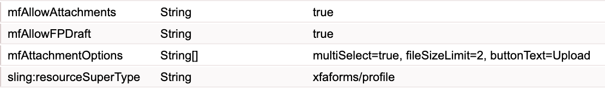

# Abilitazione degli allegati per un modulo HTML5 {#enabling-attachments-for-an-html-form}

Con i moduli HTML5 è possibile caricare, visualizzare in anteprima e inviare allegati. Per impostazione predefinita, il supporto degli allegati è disattivato. Per attivare il supporto degli allegati:

1. Crea un [profilo personalizzato](/help/forms/using/custom-profile.md) con una proprietà stringa multiselezionata `mfAttachmentOptions`. Ogni stringa nella proprietà `mfAttachmentOptions` deve avere un formato `property=value` per configurare le opzioni del widget degli allegati. `property` e `value` possono avere uno qualsiasi dei seguenti valori:

   | Proprietà | Valore |
   |--- |---|
   | multiSelect | true o false (true per impostazione predefinita) |
   | fileSizeLimit | Numero in MB (2 MB per impostazione predefinita). Ad esempio, 5. |
   | buttonText | Testo pulsante per finestra popup (&quot;Allega&quot; per impostazione predefinita) |
   | accetta | elenco separato da virgole dei tipi di file da accettare (&quot;audio/&ast;, video/&ast;, image/&ast;, text/&ast;, .pdf&quot; per impostazione predefinita) |

   Ad esempio:

   

   Se necessario, è inoltre possibile specificare altre opzioni personalizzate per la proprietà `mfAttachmentOptions`.

   >[!NOTE]
   >
   >In Microsoft Internet Explorer 9 gli utenti possono allegare file di dimensioni superiori al limite specificato. Si tratta di un problema noto.

1. Utilizza l&#39;[editor metadati](/help/forms/using/manage-form-metadata.md) per selezionare il profilo personalizzato creato in precedenza per i moduli di HTML 5.
1. Eseguire il rendering del modello di modulo con un profilo personalizzato. L&#39;icona degli allegati verrà visualizzata sulla barra degli strumenti Moduli.

   >[!NOTE]
   >
   >Il portale dei moduli fornisce automaticamente un profilo personalizzato con le funzionalità per bozze e allegati abilitate. Per ulteriori informazioni sul profilo **Salva come bozza**, vedere [Salvataggio dei moduli HTML5 come bozza](/help/forms/using/saving-html5-form-draft.md).

1. Fare clic sull&#39;icona dell&#39;allegato per visualizzare una finestra di dialogo di selezione dell&#39;allegato. Sfoglia e seleziona l&#39;allegato e fai clic su **Allega**.

   >[!NOTE]
   >
   >Per visualizzare l&#39;anteprima di un allegato, fare clic sul nome dell&#39;allegato.

   >[!NOTE]
   >
   >L’opzione di anteprima del file non è disponibile per gli utenti anonimi.

## Formato di invio dell’allegato {#attachment-submission-format}

Quando gli allegati sono abilitati, il modulo HTML5 invia dati multipart. I dati di invio in più parti contengono due parti: **dataXml** e **allegati**.

>[!NOTE]
>
>Per compatibilità con le versioni precedenti, se l&#39;opzione `mfAllowAttachments` è disattivata, i moduli HTML5 non inviano i dati in più parti. Invia dati XML semplici nel formato **application/xml**.

Se il flag mfAllowAttachments è attivato, anche il servizio proxy [submit](/help/forms/using/service-proxy.md) pubblica dati multipart con dataXml e allegati.
