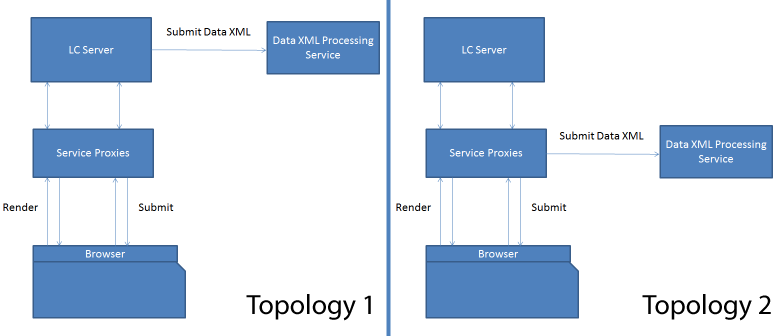

# Proxy del servizio moduli HTML5{#html-forms-service-proxy}

Il proxy di servizio HTML5 forms è una configurazione che consente di registrare un proxy per il servizio di invio. Per configurare Service Proxy, specificare l&#39;URL del servizio di invio tramite il parametro di richiesta *submitServiceProxy*.

## Vantaggi del proxy di servizio {#benefits-of-service-proxy-br}

Il proxy del servizio elimina i seguenti elementi:

* Il flusso di lavoro di HTML5 forms richiede l’apertura del servizio di invio &quot;/content/xfaforms/submit/default&quot; per gli utenti di HTML5 forms. Espone i server AEM a un pubblico non previsto più ampio.
* L’URL del servizio è incorporato nel modello di runtime del modulo. Impossibile modificare il percorso dell&#39;URL del servizio.
* L’invio è un processo in due fasi. Per inviare i dati del modulo, sono necessari almeno due percorsi al server. Di conseguenza, aumenta il carico sul server.
* I moduli HTML5 inviano i dati nella richiesta POST anziché nella richiesta PDF. Per i flussi di lavoro che coinvolgono moduli PDF e HTML5, sono necessari due diversi metodi di elaborazione degli invii.

### Topologie {#topologies-br}

I moduli HTML5 possono utilizzare le seguenti topologie per connettersi ai server AEM.

* Topologia in cui AEM Server o HTML5 Forms inviano dati al server tramite POST.
* Topologia in cui il server proxy invia i dati POST al server.

Topologie proxy del servizio HTML5 forms

I moduli HTML5 si connettono ai server AEM per eseguire script lato server, servizi Web e invii. Il runtime XFA dei moduli HTML5 utilizza chiamate Ajax sull’endpoint &quot;/bin/xfaforms/submitaction&quot; con vari parametri per la connessione ai server AEM. HTML5 forms connette i server AEM per eseguire le operazioni seguenti:

#### Esecuzione di script lato server e servizi Web {#execute-server-sided-scripts-and-web-services}

Gli script contrassegnati per l&#39;esecuzione sul server sono noti come script lato server. Nella tabella seguente sono elencati tutti i parametri utilizzati negli script lato server e nei servizi Web.

<table>
 <tbody>
  <tr>
   <td>
<strong>Parametro</strong>
 </td>
   <td>
<strong>Descrizione</strong>
 </td>
  </tr>
  <tr>
   <td>
attività
 </td>
   <td>
L’attività contiene gli eventi che attivano la richiesta. Ad esempio clic, uscita o modifica
 </td>
  </tr>
  <tr>
   <td>
contextSom
 </td>
   <td>
contextSom contiene l'espressione SOM dell'oggetto in cui vengono eseguiti gli eventi.
 </td>
  </tr>
  <tr>
   <td>
Modello
 </td>
   <td>
Il modello contiene il modello utilizzato per il rendering del modulo.
 </td>
  </tr>
  <tr>
   <td>
contentRoot
 </td>
   <td>
contentRoot contiene la directory principale del modello utilizzata per eseguire il rendering del modulo.
 </td>
  </tr>
  <tr>
   <td>
Dati
 </td>
   <td>
I dati contengono byte di dati utilizzati per il rendering del modulo.
 </td>
  </tr>
  <tr>
   <td>
formDom
 </td>
   <td>
formDom contiene DOM del modulo HTML5 in formato JSON.
 </td>
  </tr>
  <tr>
   <td>
pacchetto
 </td>
   <td>
pacchetto specificato come modulo.
 </td>
  </tr>
  <tr>
   <td>
debugDir
 </td>
   <td>
debugDir contiene la directory di debug utilizzata per il rendering del modulo.
 </td>
  </tr>
 </tbody>
</table>

#### Inviare dati {#submit-data}

Facendo clic sul pulsante Invia, i moduli di HTML5 inviano i dati al server. Nella tabella seguente sono elencati tutti i parametri inviati al server dai moduli di HTML5.

<table>
 <tbody>
  <tr>
   <td>
<strong>Parametro</strong>
 </td>
   <td>
<strong>Descrizione</strong>
 </td>
  </tr>
  <tr>
   <td>
Modello
 </td>
   <td>
Modello utilizzato per il rendering del modulo.
 </td>
  </tr>
  <tr>
   <td>
contentRoot
 </td>
   <td>
directory principale del modello utilizzata per il rendering del modulo.
 </td>
  </tr>
  <tr>
   <td>
Dati
 </td>
   <td>
byte di dati utilizzati per il rendering del modulo.
 </td>
  </tr>
  <tr>
   <td>
formDom
 </td>
   <td>
DOM del modulo HTML5 in formato JSON.
 </td>
  </tr>
  <tr>
   <td>
submiturl
 </td>
   <td>
URL in cui viene pubblicato l'XML dati.
 </td>
  </tr>
  <tr>
   <td>
debugDir
 </td>
   <td>
Directory di debug utilizzata per il rendering del modulo.
 </td>
  </tr>
 </tbody>
</table>

#### Funzionamento del proxy di invio {#how-nbsp-the-nbsp-submit-proxy-works}

Il proxy del servizio di invio funge da pass-through se il submiturl non è presente nel parametro della richiesta. Funge da pass-through. Invia la richiesta all’endpoint /bin/xfaforms/submitaction e invia la risposta al runtime XFA.

Il proxy del servizio di invio seleziona una topologia se submiturl è presente nel parametro della richiesta.

* Se i dati vengono pubblicati dai server di AEM, il servizio proxy funge da pass-through. Invia la richiesta all’endpoint /bin/xfaforms/submitaction e invia la risposta al runtime XFA.
* Se il proxy invia i dati, il servizio proxy trasmette tutti i parametri ad eccezione di submitUrl all&#39;endpoint */bin/xfaforms/submitaction* e riceve byte xml nel flusso di risposta. Successivamente, il servizio proxy invia i byte XML dei dati all&#39;elemento submitUrl per l&#39;elaborazione.

* Prima di inviare i dati (richiesta POST) a un server, i moduli HTML5 verificano la connettività e la disponibilità del server. Per verificare la connettività e la disponibilità, HTML Form invia una richiesta head vuota al server. Se il server è disponibile, il modulo HTML5 invia i dati (richiesta POST) al server. Se il server non è disponibile, viene visualizzato un messaggio di errore, *Impossibile connettersi al server,*. Il rilevamento avanzato impedisce agli utenti di riempire nuovamente il modulo. Il servlet proxy gestisce la richiesta head e non genera un’eccezione.
