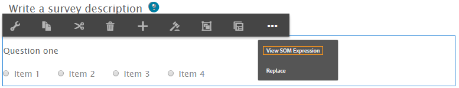

# Utilizzare le espressioni SOM nei moduli adattivi{#using-som-expressions-in-adaptive-forms}

I moduli adattivi sono modellati come pagina AEM, rappresentata come struttura di contenuto JCR nell’archivio AEM. L’elemento chiave della struttura del contenuto è il nodo guideContainer. Sotto guideContainer, è presente rootPanel che può contenere pannelli e campi nidificati.

È possibile utilizzare un modello a oggetti di script (SOM, scripting object model) per fare riferimento a valori, proprietà e metodi all&#39;interno di un particolare modello a oggetti documento (DOM, Document Object Model). Un DOM organizza gli oggetti e le proprietà di memoria in una gerarchia ad albero. Un&#39;espressione SOM fa riferimento a Campi/Disegna elementi e pannelli.

L’immagine seguente illustra una struttura di nodi a cui si traduce un modulo adattivo quando si aggiungono componenti a un modulo. Ad esempio, puoi aggiungere un pannello al pannello principale e un pulsante di scelta nel pannello che viene trasformato in DOM in fase di esecuzione. L&#39;espressione SOM per il campo pulsante di scelta nel modulo adattivo è specificata come `guide[0].guide1[0].guideRootPanel[0].panel1[0].radiobutton[0]`.

Struttura DOM

Espressione SOM per qualsiasi elemento in un modulo adattivo con prefisso `guide[0].guide1[0]`. La posizione di un componente nella gerarchia della struttura dei nodi viene utilizzata per derivare la relativa espressione SOM.

Struttura DOM con due pulsanti di scelta

L’espressione SOM cambia quando si modifica la posizione dei pulsanti di scelta nel modulo adattivo. Nella modalità di authoring, è possibile visualizzare l’espressione SOM di un campo o di un elemento all’interno di AEM Forms utilizzando l’opzione Visualizza espressione SOM. L’opzione viene visualizzata nel pannello e quando fai clic con il pulsante destro del mouse sul campo o sull’elemento.

Estrazione di espressioni SOM in un modulo adattivo

All’interno dei pannelli, puoi accedere alla funzione dalla barra degli strumenti del pannello. La funzione facilita la creazione di script da parte di autori di moduli adattivi.

Estrazione di espressioni SOM tramite la barra degli strumenti del pannello

Alcune API elencate in [GuideBridge](https://helpx.adobe.com/aem-forms/6/javascript-api/GuideBridge.html) utilizzano l&#39;espressione SOM di un elemento. Ad esempio, per spostare lo stato attivo su un particolare campo in un modulo adattivo, passa l’espressione SOM corrispondente all’API `getFocus` in `guideBridge`.
