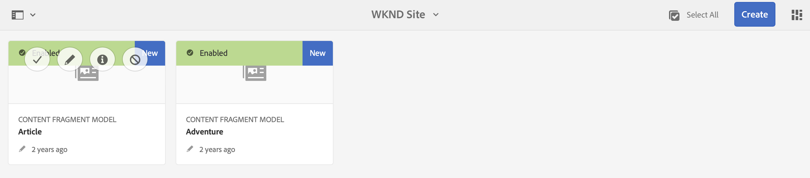
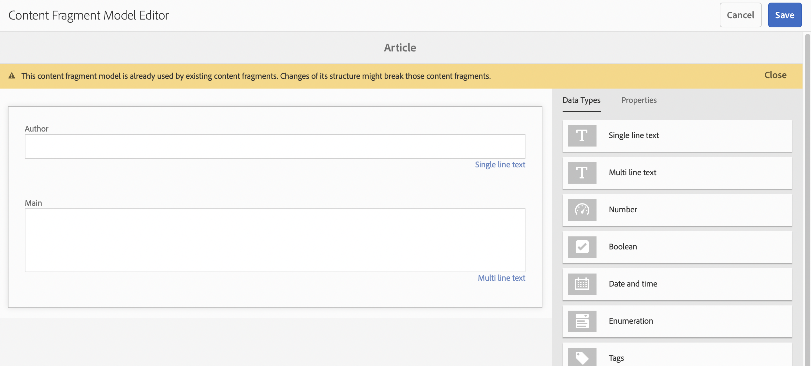
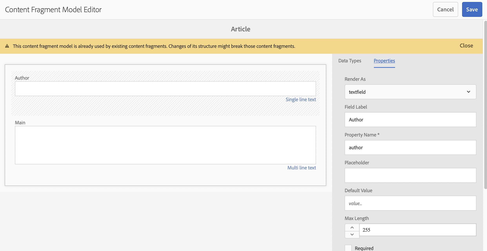

# Guida introduttiva alla traduzione in AEM headless {#getting-started}

Scopri come organizzare i contenuti headless e come funzionano gli strumenti di traduzione di AEM.

## Percorso affrontato finora {#story-so-far}

Nel documento precedente del percorso di traduzione in AEM headless [Scopri i contenuti headless e come tradurre in AEM](learn-about.md), hai appreso le conoscenze di base su cosa si intende con CMS headless e ora dovresti:

* Comprendere i concetti di base sulla distribuzione headless dei contenuti.
* Sapere come AEM supporta i contenuti headless e la traduzione.

Questo articolo si basa su questi elementi fondamentali che ti consentono di comprendere come AEM memorizza e gestisce i contenuti headless, e come puoi utilizzare gli strumenti di traduzione di AEM per tradurre quei contenuti.

## Obiettivo {#objective}

Questo documento ti aiuta a capire come iniziare a tradurre il contenuto headless in AEM. Dopo la lettura dovresti:

* L’importanza della struttura dei contenuti per la traduzione.
* Come AEM archivia il contenuto headless.
* Gli strumenti di traduzione di AEM.

## Requisiti e prerequisiti {#requirements-prerequisites}

Ci sono diversi requisiti prima di iniziare a tradurre il contenuto AEM headless.

### Conoscenza {#knowledge}

* Esperienza nella traduzione dei contenuti in un CMS
* Esperienza utilizzando le funzioni di base di un CMS su larga scala
* Avere una conoscenza operativa dei fondamenti di AEM
* Comprensione del servizio di traduzione utilizzato
* Comprensione di base del contenuto che si sta traducendo

>[!TIP]
>
>Se non hai familiarità con l&#39;utilizzo di un CMS su larga scala come AEM, consulta il documento [Operazioni di base](/help/sites-authoring/basic-handling.md) prima di procedere. La documentazione sulle operazioni di base non fa parte del percorso, quindi torna a questa pagina una volta completata.

### Strumenti {#tools}

* Accesso alla sandbox per testare la traduzione del contenuto
* Credenziali per la connessione al servizio di traduzione preferito
* Essere membro del gruppo `projects-administrators` in AEM

## La struttura è la chiave {#content-structure}

Il contenuto di AEM, sia esso headless o costituito da pagine web tradizionali, è basato sulla sua struttura. AEM impone pochi requisiti alla struttura dei contenuti, ma un’attenta considerazione della gerarchia dei contenuti come parte della pianificazione del progetto può rendere la traduzione molto più semplice.

>[!TIP]
>
>Pianifica la traduzione all’inizio del progetto headless. Collabora con il project manager e gli architetti di contenuti fin da subito.
>
>Un Project Manager per l&#39;internazionalizzazione può essere richiesto come persona separata la cui responsabilità è quella di definire quali contenuti tradurre e cosa no, e quali contenuti tradotti possono essere modificati dai produttori di contenuti regionali o locali.

## Come AEM archivia i contenuti headless {#headless-content-in-aem}

Per lo specialista della traduzione, non è importante comprendere in modo approfondito come AEM gestisce i contenuti headless. Tuttavia, conoscere i concetti e la terminologia di base sarà utile in seguito all’utilizzo di strumenti di traduzione AEM. Ma soprattutto, devi comprendere i contenuti e come sono strutturati per tradurli in modo efficace.

### Modelli di contenuto {#content-models}

Affinché i contenuti headless possano essere distribuiti in modo coerente tra canali, aree geografiche e lingue diverse, i contenuti devono essere estremamente strutturati. AEM utilizza i modelli di contenuto per applicare questa struttura. Pensa ai modelli di contenuto come a un tipo di modello o pattern per la creazione di contenuti headless. Poiché ogni progetto ha le proprie esigenze, ogni progetto definisce i propri modelli di frammenti di contenuto. AEM non ha requisiti o struttura fissi per tali modelli.

L’architetto dei contenuti all’inizio del progetto si occupa della definizione di questa struttura. Il persnale esperto di traduzione, dovrebbe collaborare strettamente con l’architetto dei contenuti per comprendere e organizzare i contenuti.

>[!NOTE]
>
>Spetta all’architetto dei contenuti definire i modelli di contenuto. Le persone specializzate nella traduzione devono avere familiarità solo con la loro struttura come descritto nei passaggi seguenti.

Poiché i modelli di contenuto definiscono la struttura del contenuto, è necessario sapere quali campi dei modelli devono essere tradotti. In genere si lavora con l’architetto dei contenuti per deciderlo. Per sfogliare i campi dei modelli di contenuto, effettua le seguenti operazioni.

1. Passa a **Strumenti** > **Assets** > **Modelli per frammenti di contenuto**.
1. I modelli per frammenti di contenuto sono generalmente memorizzati in una struttura di cartelle. Fai clic sulla cartella del progetto.
1. I modelli sono elencati. Fai clic sul modello per visualizzare i dettagli.
   
1. L’**Editor modello frammento di contenuto** si apre.
   1. La colonna a sinistra contiene i campi del modello. Questa colonna ci interessa.
   1. La colonna a destra contiene i campi che si possono aggiungere al modello. Si può ignorare questa colonna.
      
1. Fate clic su uno dei campi del modello. AEM lo contrassegna e i dettagli di quel campo sono visualizzati nella colonna a destra.
   

Prendi nota del campo **Nome proprietà** per tutti i campi che devono essere tradotti. Queste informazioni saranno necessarie più avanti nel percorso. Questi **Nome proprietà** s sono necessari per informare AEM su quali campi del contenuto devono essere tradotti.

>[!TIP]
>
>In genere l&#39;architetto dei contenuti fornisce allo specialista della traduzione **Nome proprietà** di tutti i campi necessari per la traduzione. Questi nomi di campo sono necessari per una fase successiva del percorso. Le fasi precedenti sono fornite per la comprensione dello specialista della traduzione.

### Frammenti di contenuto {#content-fragments}

I modelli di contenuto vengono utilizzati dagli autori dei contenuti per creare il contenuto headless effettivo. Gli autori dei contenuti selezionano il modello su cui basare i propri contenuti e quindi creano frammenti di contenuto. I frammenti di contenuto sono istanze dei modelli e rappresentano il contenuto effettivo da distribuire senza problemi.

Se i modelli di contenuto sono i pattern per il contenuto, i frammenti di contenuto sono il contenuto effettivo basato su tali pattern. I frammenti di contenuto rappresentano il contenuto da tradurre.

I frammenti di contenuto sono gestiti come risorse in AEM come parte della gestione delle risorse digitali (DAM). Questo è importante, in quanto si trovano tutti sotto il percorso `/content/dam`.

## Struttura dei contenuti consigliata {#recommended-structure}

Come precedentemente consigliato, collabora con l’architetto dei contenuti per determinare la struttura appropriata per il tuo progetto. Tuttavia la seguente è una struttura collaudata, semplice e intuitiva che è abbastanza efficace.

Definire una cartella di base per il progetto in `/content/dam`.

```text
/content/dam/<your-project>
```

La lingua in cui viene creato il contenuto è denominata lingua root. Nel nostro esempio è inglese e dovrebbe essere sotto questo percorso.

```text
/content/dam/<your-project>/en
```

Tutti i contenuti di progetto che potrebbero essere localizzati devono essere posizionati sotto la lingua root.

```text
/content/dam/<your-project>/en/<your-project-content>
```

Le traduzioni devono essere create come cartelle di pari livello accanto alla lingua root con il nome della cartella che rappresenta il codice della lingua ISO-2. Ad esempio, il percorso per il tedesco è il seguente.

```text
/content/dam/<your-project>/de
```

>[!NOTE]
>
>L’architetto dei contenuti è generalmente responsabile della creazione di queste cartelle linguistiche. Se non vengono create, AEM non sarà in grado di elaborare successivamente i processi di traduzione.

La struttura finale può avere un aspetto simile al seguente.

```text
/content
    |- dam
        |- your-project
            |- en
                |- some
                |- exciting
                |- headless
                |- content
            |- de
            |- fr
            |- it
            |- ...
        |- another-project
        |- ...
```

È necessario prendere nota del percorso specifico del contenuto, in quanto sarà necessario in seguito per configurare la traduzione.

>[!NOTE]
>
>In genere è responsabilità dell’architetto di contenuti definirne la struttura, spesso in collaborazione con la persona specializzata nella traduzione.
>
>Qui è dettagliato per la completezza.

## Strumenti di traduzione AEM {#translation-tools}

Ora che conosci i frammenti di contenuto e l’importanza della struttura dei contenuti, possiamo vedere come tradurre tali contenuti. Gli strumenti di traduzione in AEM sono abbastanza potenti, ma sono semplici da comprendere ad alto livello.

* **Connettore di traduzione**: il connettore è il collegamento tra AEM e il servizio di traduzione utilizzato.
* **Regole di traduzione**: le regole definiscono quali contenuti in determinati percorsi dovrebbero essere tradotti.
* **Progetti di traduzione**: i progetti di traduzione raccolgono contenuti che devono essere affrontati come un&#39;unica traduzione e ne tengono traccia dei progressi, interfacciandosi con il connettore per trasmettere il contenuto da tradurre e riceverlo nuovamente dal servizio di traduzione.

In genere il connettore viene configurato una sola volta per l’istanza e le regole per progetto headless. Poi utilizzi i progetti di traduzione per tradurre i contenuti e tenerne aggiornate le traduzioni su base continua.

## Passaggio successivo {#what-is-next}

Ora cha hai completato questa parte del percorso di traduzione headless, dovresti:

* comprendere l’importanza della struttura dei contenuti per la traduzione.
* Come AEM archivia il contenuto headless.
* Gli strumenti di traduzione di AEM.

Approfondisci l&#39;argomento e continua il tuo percorso di traduzione headless AEM consultando il documento successivo [Configurare l&#39;integrazione della traduzione](configure-connector.md) dove verrà illustrato come connettere AEM a un servizio di traduzione.|

## Risorse aggiuntive {#additional-resources}

Mentre si consiglia di procedere alla parte successiva del percorso di traduzione headless consultando il documento [Configurare il connettore di traduzione](configure-connector.md), ci sono risorse aggiuntive e facoltative che approfondiscono alcuni concetti menzionati in questo documento, ma che non sono necessarie per continuare nel percorso headless.

* [Operazioni di base AEM](/help/sites-authoring/basic-handling.md): scopri le nozioni di base dell’interfaccia utente AEM per navigare comodamente ed eseguire attività essenziali come la ricerca dei contenuti.
* [Identificazione del contenuto da tradurre](/help/sites-administering/tc-rules.md): scopri come le regole di traduzione identificano i contenuti da tradurre.
* [Configurazione del Translation Integration Framework](/help/sites-administering/tc-tic.md): scopri come configurare il Translation Integration Framework per l’integrazione con i servizi di traduzione di terze parti.
* [Gestione dei progetti di traduzione](/help/sites-administering/tc-manage.md): scopri come creare e gestire progetti di traduzione automatica e umana in AEM.
* [Introduzione ad AEM come CMS headless](/help/sites-developing/headless/introduction.md)
* Il [Portale per sviluppatori AEM](https://experienceleague.adobe.com/landing/experience-manager/headless/developer.html?lang=it)
* [Tutorial per contenuti headless in AEM](https://experienceleague.adobe.com/it/docs/experience-manager-learn/getting-started-with-aem-headless/overview)
