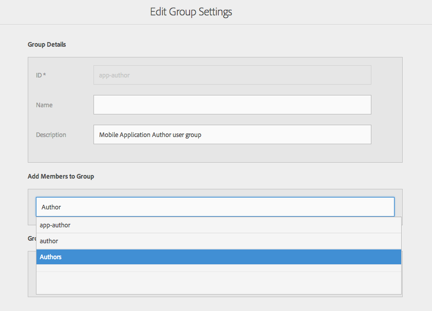
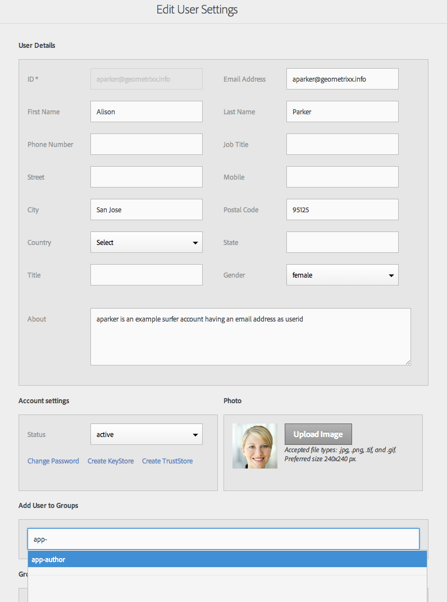
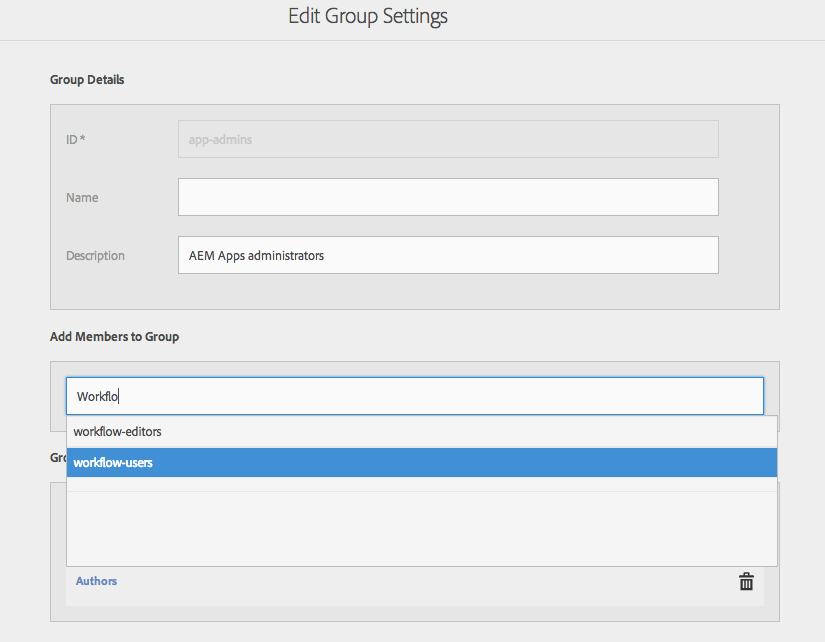
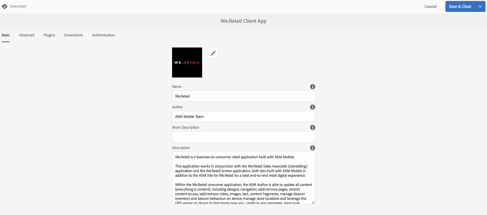

# Configurare utenti e gruppi di utenti {#configure-your-users-and-user-groups}

{{ue-over-mobile}}

Questo capitolo descrive i ruoli utente e le modalità di configurazione di utenti e gruppi per supportare l’authoring e la gestione delle app mobili.

## Utenti dell’applicazione AEM Mobile e amministrazione dei gruppi {#aem-mobile-application-users-and-group-administration}

Per organizzare e gestire il modello di autorizzazioni per le app AEM, sono disponibili i due gruppi seguenti:

* app-admins per amministratori di app
* autori di app per autori di app

### Autori di contenuti di applicazioni AEM Mobile (gruppo app-author) {#aem-mobile-application-content-authors-app-author-group}

I membri del gruppo autore dell’app sono responsabili dell’authoring dei contenuti delle app mobili AEM, tra cui pagine, testo, immagini e video.

#### Configurazione del gruppo - autori-app {#group-configuration-app-authors}

1. Crea un gruppo di utenti denominato, &quot;app-authors&quot;:

   Passa all&#39;Admin Console utente: [http://localhost:4502/libs/granite/security/content/groupadmin.html](http://localhost:4502/libs/granite/security/content/groupadmin.html)

   Dalla console del gruppo di utenti, seleziona il pulsante &quot;+&quot; per creare un gruppo.

   Imposta l’ID di questo gruppo su &quot;app-authors&quot; per indicare che si tratta di un tipo specifico di gruppo di utenti Author specifico per l’authoring di applicazioni mobili all’interno di AEM.

1. Aggiungi membro al gruppo: Autori

   

   Aggiungere autori delle app al gruppo Autori

1. Dopo aver creato il gruppo utenti autori app, è possibile aggiungere singoli membri del gruppo a questo nuovo gruppo tramite l&#39;[Admin Console utente](http://localhost:4502/libs/granite/security/content/useradmin.md).

   

   Modifica gruppi di utenti

1. Passa alla [console Autorizzazioni](http://localhost:4502/useradmin) e aggiungi le autorizzazioni per amministrare i servizi cloud

   * (Leggi) su /etc/cloudservices

   >[!NOTE]
   >
   >Gli autori delle app estendono il gruppo predefinito di autori di contenuti (Autori) da AEM, in modo che possano creare contenuti in /content/phonegap

### AEM Mobile Application Administrators Group (gruppo app-admins) {#aem-mobile-application-administrators-group-app-admins-group}

I membri del gruppo app-admins possono creare contenuti dell&#39;applicazione con le stesse autorizzazioni incluse con gli autori dell&#39;app **AND**, inoltre, sono responsabili di:

* Configurazione di PhoneGap Build e dei servizi cloud di Adobe Mobile Services in AEM
* Staging, pubblicazione e cancellazione dell&#39;applicazione Content Sync OTA updates

>[!NOTE]
>
>Le autorizzazioni determinano la disponibilità di alcune azioni dell’utente nel Command Center di AEM App.
>
>Tieni presente che alcune opzioni non sono disponibili per gli autori di app che sono disponibili per gli amministratori di app.

#### Configurazione del gruppo - app-admins {#group-configuration-app-admins}

1. Crea un gruppo denominato app-admins.
1. Aggiungi i seguenti gruppi al nuovo gruppo app-admins:

   * content-authors
   * workflow-users

   

1. Passa alla [console Autorizzazioni](http://localhost:4502/useradmin) e aggiungi le autorizzazioni per amministrare i servizi cloud

   * (Lettura, modifica, creazione, eliminazione, replica) in /etc/cloudservices/mobileservices
   * (Lettura, modifica, creazione, eliminazione, replica) in /etc/cloudservices/phonegap-build

1. Nella stessa console Autorizzazioni, aggiungi le autorizzazioni per staging, pubblicazione e cancellazione degli aggiornamenti dei contenuti dell’app

   * (Lettura, modifica, creazione, eliminazione, replica) in /etc/packages/mobileapp
   * (Lettura) su /var/contentsync

   >[!NOTE]
   >
   >La replica dei pacchetti viene utilizzata per pubblicare gli aggiornamenti dell’app dall’istanza di authoring a quella di pubblicazione

   >[!CAUTION]
   >
   >L’accesso /var/contentsync è negato come standard.
   >
   >Se si omette l’autorizzazione READ, è possibile che vengano generati e replicati pacchetti di aggiornamento vuoti.

1. Aggiungi membri al gruppo in base alle esigenze

## Autorizzazioni delle sezioni del dashboard {#dashboard-tile-permissions}

I riquadri del dashboard possono esporre azioni diverse in base alle autorizzazioni di cui dispone l’utente. Di seguito sono descritte le azioni disponibili per ogni sezione.

Oltre a queste autorizzazioni, un’azione può anche essere visualizzata/nascosta in base alla configurazione dell’app corrente. Ad esempio, se all’app non è stata assegnata alcuna configurazione cloud PhoneGap, l’azione &quot;Remote Build&quot; non verrà esposta in alcun modo. Questi sono elencati di seguito nelle sezioni &#39;**Condizione di configurazione**&#39;.

### Gestisci sezione app {#manage-app-tile}

Al momento il riquadro non presenta azioni che richiedono autorizzazioni, tuttavia la pagina dei dettagli dell’applicazione presenta le azioni seguenti:

* *Modifica* per app-author e app-admin (trigger interfaccia utente - jcr:write - in /content/phonegap/{suffix})
* *Scarica* per app-author e app-admin (trigger interfaccia utente - su /content/phonegap/{suffix})

L’immagine seguente mostra le opzioni Scarica e Modifica per un’app:

