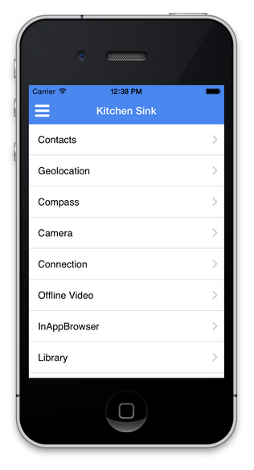

# Accedere alle funzioni del dispositivo{#access-device-features}

{{ue-over-mobile}}

## Creazione di componenti Adobe Experience Manager (AEM) che accedono alle funzioni del dispositivo {#building-aem-components-that-access-device-features}

L&#39;archivio GitHub [AEM PhoneGap Kitchen Sink](https://github.com/blefebvre/aem-phonegap-kitchen-sink) fornisce agli sviluppatori un&#39;app AEM funzionale che illustra l&#39;utilizzo di diverse API Cordova di base. Quando viene eseguita su iOS o Android™ tramite PhoneGap CLI, l’app si apre nella pagina seguente contenente un collegamento a ogni API del dispositivo:

Il codice sorgente per ciascuno di questi componenti API del dispositivo è [disponibile su GitHub](https://github.com/blefebvre/aem-phonegap-kitchen-sink/tree/master/content/src/main/content/jcr_root/apps/brucelefebvre/kitchen-sink/components).

Per ulteriori dettagli sull&#39;utilizzo di ciascuna API, consulta la documentazione del plug-in Cordova (`https://docs.phonegap.com/en/4.0.0/cordova_plugins_pluginapis.md.html`).

## Passaggi successivi {#the-next-steps}

Vedi [Tracciare le prestazioni dell&#39;app con Adobe Mobile Analytics](/help/mobile/phonegap-intro-to-app-analytics.md).
