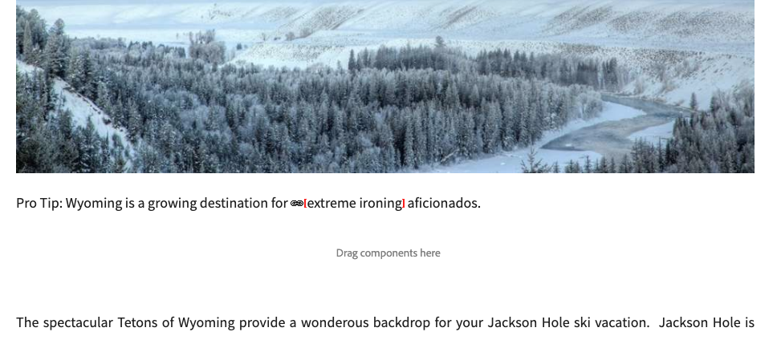
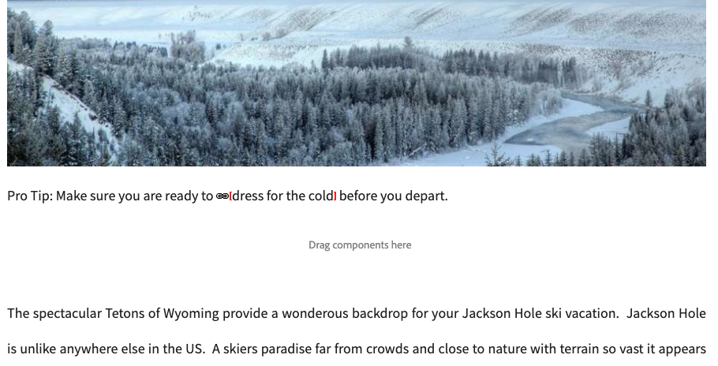

# La verifica collegamenti {#the-link-checker}

Gli autori dei contenuti non devono preoccuparsi di convalidare ogni collegamento incluso nelle pagine dei contenuti.

Il Link Checker viene eseguito automaticamente per aiutare gli autori di contenuti con i loro collegamenti, tra cui:

* Convalida dei collegamenti quando vengono aggiunti al contenuto
* Visualizzazione di un elenco di tutti i collegamenti esterni nel contenuto
* Esecuzione delle trasformazioni dei collegamenti

Il Link Checker dispone di diverse [opzioni di configurazione](#configuring), ad esempio la definizione della convalida interna, che consente di omettere alcuni collegamenti o percorsi di collegamento dalla convalida e la riscrittura delle regole di riscrittura dei collegamenti.

Verifica collegamenti convalida [collegamenti interni](#internal) e [collegamenti esterni.](#external)

>[!NOTE]
>
>Poiché il Link Checker controlla i collegamenti di ogni pagina di contenuto, può influire sulle prestazioni di archivi di grandi dimensioni. In questi casi, potrebbe essere necessario [configurare la frequenza di esecuzione di Verifica collegamenti](#configuring) o [disabilitarlo.](#disabling)

## Verifica dei collegamenti interni {#internal}

I collegamenti interni sono collegamenti ad altri contenuti nell’archivio di AEM. È possibile aggiungere collegamenti interni utilizzando il selettore di percorsi dell’editor Rich Text o utilizzando un componente personalizzato. Ad esempio:

* Pagina `/content/wknd/us/en/adventures/ski-touring.html`
* Contiene un collegamento a `/content/wknd/us/en/adventures/extreme-ironing.html` in un [componente testo.](https://experienceleague.adobe.com/docs/experience-manager-core-components/using/components/text.html?lang=it)

I collegamenti interni vengono convalidati non appena l’autore di contenuto aggiunge un collegamento interno a una pagina. Se il collegamento non è più valido:

* Viene rimosso dall’editore. Il testo del collegamento rimane, ma il collegamento stesso viene rimosso.
* Viene visualizzato come collegamento interrotto nell’interfaccia di authoring.

## Verifica collegamenti esterni {#external}

I collegamenti esterni sono collegamenti a contenuti esterni all’archivio AEM. È possibile aggiungere collegamenti esterni utilizzando l’editor Rich Text o un componente personalizzato. Ad esempio:

* Pagina `/content/wknd/us/en/adventures/ski-touring.html`
* Contiene un collegamento a `https://bunwarmerthermalunderwear.com` in un [componente testo.](https://experienceleague.adobe.com/docs/experience-manager-core-components/using/components/text.html?lang=it)

I collegamenti esterni vengono convalidati per la sintassi e verificandone la disponibilità. Questo controllo viene eseguito in modo asincrono in un ambiente interno configurabile. Se Verifica collegamenti rileva un collegamento esterno non valido:

* Viene rimosso dall’editore. Il testo del collegamento rimane, ma il collegamento stesso viene rimosso.
* Viene visualizzato come collegamento interrotto nell’interfaccia di authoring.

Inoltre, l&#39;interfaccia di [Verifica collegamenti esterni](#external-link-checker) fornisce una panoramica di tutti i collegamenti esterni nelle pagine di contenuto.

### Utilizzo di Verifica collegamenti esterni {#external-link-checker}

Per utilizzare Verifica collegamenti esterni:

1. Utilizzando **Navigazione**, seleziona **Strumenti**, quindi **Siti**.
1. Selezionare **Verifica collegamenti esterni** e viene visualizzato un elenco di tutti i collegamenti esterni.

Vengono visualizzate le seguenti informazioni:

* **Stato** - Lo stato di convalida del collegamento, che può essere uno dei seguenti:
  * **Valido** - Il collegamento esterno è raggiungibile da Verifica collegamenti
  * **In sospeso** - Il collegamento esterno è stato aggiunto al contenuto del sito, ma non è stato ancora convalidato da Verifica collegamenti
  * **Non valido** - Il collegamento esterno non è raggiungibile dal Link Checker
* **URL** - Il collegamento esterno
* **Destinatario che inoltra**: la pagina di contenuto che contiene il collegamento esterno
  * Viene popolato solo [se configurato.](#configuring)
* **Ultimo controllo** - L&#39;ultima volta che Verifica collegamenti ha convalidato il collegamento esterno
  * La frequenza con cui vengono controllati i collegamenti [ è configurabile.](#configuring)
* **Ultimo stato** - L&#39;ultimo codice di stato di HTML restituito quando il collegamento selezionato ha controllato l&#39;ultimo collegamento esterno
* **Ultima disponibilità** - Ora dall&#39;ultima disponibilità del collegamento per Verifica collegamenti
* **Ultimo accesso** - ora dall&#39;ultimo accesso alla pagina con il collegamento esterno nell&#39;interfaccia di creazione

Puoi modificare il contenuto della finestra utilizzando i due pulsanti nella parte superiore dell’elenco dei collegamenti:

* **Aggiorna** - Per aggiornare il contenuto dell&#39;elenco
* **Verifica** - Per controllare un singolo collegamento esterno selezionato nell&#39;elenco

### Funzionamento di Verifica collegamenti esterni {#how-it-works}

Anche se facile da usare, il Link Checker esterno si basa su diversi servizi e comprendere come funzionano ti aiuta a capire come [configurare il Link Checker](#configuring) per soddisfare le tue esigenze.

1. Ogni volta che un autore di contenuti salva un collegamento a una pagina, viene attivato un gestore eventi.
1. Il gestore eventi analizza tutto il contenuto in `/content` e verifica la presenza di collegamenti nuovi o aggiornati e li aggiunge a una cache per Verifica collegamenti.
1. Il servizio **Day CQ Link Checker** viene quindi eseguito regolarmente per verificare la presenza di una sintassi valida nelle voci della cache.
1. I collegamenti convalidati dalla sintassi vengono quindi visualizzati nella finestra [Verifica collegamenti esterni](#external-link-checker). Tuttavia, saranno in uno stato **Pending**.
1. L&#39;attività **Day CQ Link Checker** viene quindi eseguita regolarmente per convalidare i collegamenti effettuando una chiamata GET.
1. L&#39;attività **Day CQ Link Checker** aggiorna quindi le voci nella finestra External Link Checker con i risultati delle chiamate GET.

## Configurazione di Verifica collegamenti {#configuring}

Il Link Checker è disponibile automaticamente come strumento pronto all’uso in AEM. Tuttavia, esistono diverse configurazioni OSGi che possono essere modificate per modificarne il comportamento:

* **Servizio di archiviazione informazioni verifica collegamenti Day CQ** - Questo servizio definisce la dimensione della cache di Verifica collegamenti nell&#39;archivio.
* **Day CQ Link Checker Service** - Questo servizio esegue il controllo asincrono della sintassi dei collegamenti esterni. È possibile definire il periodo di controllo e quali tipi di collegamenti vengono ignorati dallo strumento di controllo, tra le altre opzioni.
* **Attività Controllo collegamenti CQ Day** - Questo servizio esegue la convalida GET dei collegamenti esterni. Consente definizioni separate degli intervalli per verificare collegamenti errati e validi tra le altre opzioni.
* **Day CQ Link Checker Transformer** - Consente la conversione di collegamenti in base a un set di regole definito dall&#39;utente.

Per ulteriori informazioni su come modificare le impostazioni OSGi, consulta il documento [Impostazioni di configurazione OSGi](/help/sites-deploying/osgi-configuration-settings.md).

## Disattivazione di Verifica collegamenti {#disabling}

Puoi scegliere di disabilitare completamente Verifica collegamenti. Per eseguire questa operazione:

1. Apri la console OSGi.
1. Modifica il trasformatore **Day CQ Link Checker**
1. Selezionare le opzioni che si desidera disattivare:
   * **Disabilita controllo** - per disabilitare la convalida dei collegamenti
   * **Disabilita riscrittura** - per disabilitare le trasformazioni dei collegamenti

>[!NOTE]
>
>Se si disabilita il controllo dei collegamenti dopo aver iniziato a creare il contenuto, è possibile che vengano ancora visualizzate le voci nella [finestra Verifica collegamenti esterni](#external-link-checker), ma non verranno più aggiornate.
