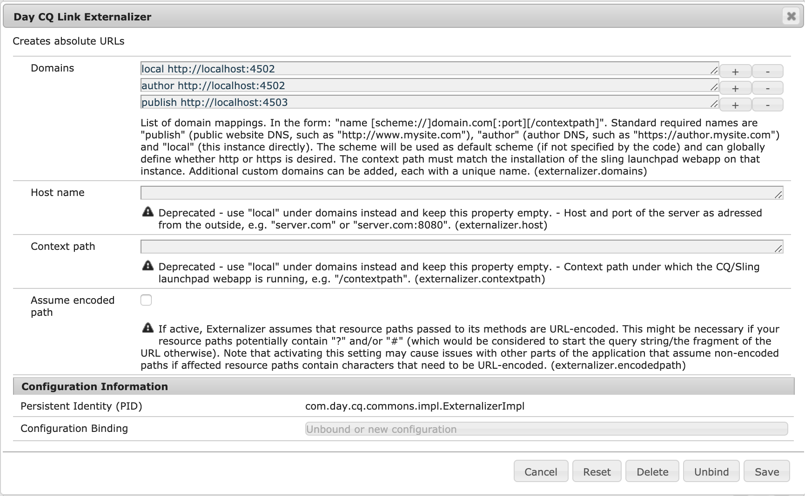

# Prerequisiti per l’integrazione con Adobe Target{#prerequisites-for-integrating-with-adobe-target}

Come parte dell&#39;integrazione [di AEM e Adobe Target](/help/sites-administering/target.md), è necessario registrarsi ad Adobe Target, configurare l&#39;agente di replica e proteggere le impostazioni delle attività sul nodo di pubblicazione.

## Registrazione ad Adobe Target {#registering-with-adobe-target}

Per integrare AEM con Adobe Target, devi disporre di un account Adobe Target valido. Questo account deve disporre almeno delle autorizzazioni di **livello approvatore**. Quando ti registri a Adobe Target, ricevi un codice cliente. Per collegare AEM ad Adobe Target sono necessari il codice cliente e il nome di accesso e la password di Adobe Target.

Il codice client identifica l’account cliente Adobe Target quando si chiama il server Adobe Target.

>[!NOTE]
>
>Per utilizzare l’integrazione, il team di Target deve anche abilitare il tuo account.
>
>In caso contrario, contatta l&#39;[Assistenza clienti Adobe](https://experienceleague.adobe.com/docs/target/using/cmp-resources-and-contact-information.html?lang=it).

## Abilitazione dell’agente di replica di Target {#enabling-the-target-replication-agent}

L&#39;agente di replica [di test e destinazione](/help/sites-deploying/replication.md) deve essere abilitato nell&#39;istanza di authoring. Questo agente di replica non è abilitato per impostazione predefinita se è stata utilizzata la modalità di esecuzione [nosamplecontent](/help/sites-deploying/configure-runmodes.md#using-samplecontent-and-nosamplecontent) per l&#39;installazione di AEM. Per ulteriori informazioni sulla protezione dell&#39;ambiente di produzione, vedere [Elenco di controllo protezione](/help/sites-administering/security-checklist.md).

1. Nella home page di AEM, fai clic su **Strumenti** > **Distribuzione** > **Replica**.
1. Fare Clic Su **Agenti Per L&#39;Autore**.
1. Fare clic sull&#39;agente di replica **Test and Target (test and target)** e quindi su **Modifica**.
1. Selezionare l&#39;opzione Abilitato, quindi fare clic su **OK**.

   >[!NOTE]
   >
   >Quando si configura l&#39;agente di replica di Test and Target, nella scheda **Trasporto**, l&#39;URI è impostato per impostazione predefinita su **tnt:///**. Non sostituire questo URI con **https://admin.testandtarget.omniture.com**.
   >
   >Se si tenta di verificare la connessione con **tnt:///**, verrà generato un errore. Si tratta di un comportamento previsto poiché questo URI è solo per uso interno; non utilizzare con **Verifica connessione**.

## Protezione del nodo Impostazioni attività {#securing-the-activity-settings-node}

Proteggere il nodo delle impostazioni delle attività **cq:ActivitySettings** nell&#39;istanza di pubblicazione in modo che sia inaccessibile agli utenti normali. Il nodo delle impostazioni delle attività deve essere accessibile solo al servizio che gestisce la sincronizzazione delle attività con Adobe Target.

Il nodo **cq:ActivitySettings** è disponibile in CRXDE lite in `/content/campaigns/*nameofbrand*`** sotto il nodo attività jcr:content;* *ad esempio, `/content/campaign/we-retail/master/myactivity/jcr:content/cq:ActivitySettings`. Questo nodo viene creato solo dopo aver eseguito il targeting di un componente.

Il nodo **cq:ActivitySettings** sotto il jcr:content dell&#39;attività è protetto dai seguenti ACL:

* Nega tutto per tutti
* Consenti jcr:read,rep:write per &quot;target-activity-authors&quot; (l&#39;autore è un membro di questo gruppo preconfigurato)
* Consenti jcr:read,rep:write per &quot;targetservice&quot;

Queste impostazioni garantiscono che gli utenti normali non abbiano accesso alle proprietà del nodo. Utilizza gli stessi ACL per l’authoring e per la pubblicazione. Per ulteriori informazioni, vedere [Amministrazione utenti e sicurezza](/help/sites-administering/security.md).

## Configurazione di AEM Link Externalizer {#configuring-the-aem-link-externalizer}

Quando modifichi un&#39;attività in Adobe Target, l&#39;URL punta a **localhost** a meno che non modifichi l&#39;URL nel nodo di authoring di AEM. Puoi configurare AEM Link Externalizer se desideri che il contenuto esportato punti a uno specifico dominio *publish*.

>[!NOTE]
>
>Vedi anche [Aggiungere la configurazione cloud](/help/sites-administering/experience-fragments-target.md#add-the-cloud-configuration).

Per configurare AEM Externalizer:

>[!NOTE]
>
>Per ulteriori dettagli, vedere [Esternalizzazione degli URL](/help/sites-developing/externalizer.md).

1. Passa alla console Web OSGi all&#39;indirizzo **https://&lt;server>:&lt;porta>/system/console/configMgr.**
1. Trova **Day CQ Link Externalizer** e immetti il dominio per il nodo di authoring.

   
