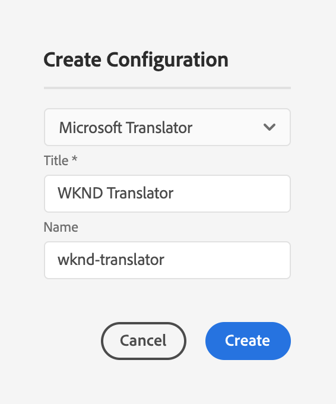
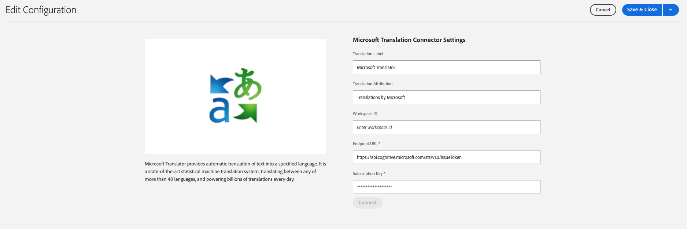

# Connetti a Microsoft Translator {#connecting-to-microsoft-translator}

AEM fornisce un connettore integrato per [Microsoft Translator](https://www.microsoft.com/it-it/translator/business/) per tradurre il contenuto o le risorse di una pagina. Dopo aver ottenuto una licenza da Microsoft per utilizzare Microsoft Translator, configura il connettore seguendo le istruzioni riportate in questa pagina.

| Proprietà | Descrizione |
|---|---|
| Etichetta traduzione | Il nome visualizzato per il servizio di traduzione |
| Attribuzione traduzione | (Facoltativo) Per i contenuti generati dall&#39;utente, l&#39;attribuzione visualizzata accanto al testo tradotto, ad esempio `Translations by Microsoft` |
| ID area di lavoro | (Facoltativo) L’ID del motore di Microsoft Translator personalizzato da utilizzare |
| Chiave di sottoscrizione | La chiave di abbonamento a Microsoft per Microsoft Translator |

La procedura seguente crea una configurazione di Microsoft Translator.

1. Nel [pannello di navigazione,](/help/sites-authoring/basic-handling.md#first-steps) fai clic su **Strumenti** > **Servizi cloud** > **Servizi cloud di traduzione**.
1. Passa alla posizione in cui desideri creare la configurazione. Normalmente si trova nel sito principale oppure può essere una configurazione globale predefinita.
1. Fai clic sul pulsante **Crea**.
1. Definisci la configurazione.
   1. Seleziona **Microsoft Translator** nel menu a discesa.
   1. Digita un titolo per la configurazione. Il titolo identifica la configurazione sia nella console Cloud Services che negli elenchi a discesa delle proprietà della pagina.
   1. Facoltativamente, digita un nome da utilizzare per il nodo dell’archivio che memorizza la configurazione.

   

1. Fai clic su **Crea**.
1. Nella finestra **Modifica configurazione**, indica i valori per il servizio di traduzione descritto nella tabella precedente.

   

1. Fai clic su **Connetti** per verificare la connessione.
1. Fai clic su **Salva e chiudi**.

## Pubblicazione delle configurazioni del servizio Translator {#publishing-the-translator-service-configurations}

Come ultimo passaggio, pubblica le configurazioni di Microsoft Translator per supportare i contenuti tradotti pubblicati, utilizzando l&#39;azione [pubblicazione di una struttura](/help/sites-authoring/publishing-pages.md#publishing-and-unpublishing-a-tree).

## Mappatura dei campi dell’API di Microsoft Translator {#microsoft-translator-api-field-mapping}

Microsoft Translator API v3 accetta le richieste di traduzione in `https://api.cognitive.microsofttranslator.com/translate?api-version=3.0`. Per i parametri richiesti, incluso il linguaggio di destinazione, vedere il riferimento [Microsoft Translate API](https://learn.microsoft.com/en-us/azure/ai-services/translator/text-translation/reference/v3/translate).

La tabella seguente mette in relazione i campi di configurazione di AEM con l’API Microsoft.

| Campo AEM | Finalità in AEM | Relazione API Microsoft |
|---|---|---|
| ID area di lavoro | Identifica il motore di Microsoft Translator personalizzato da utilizzare. | I sistemi di traduzione personalizzati sono selezionati tramite il parametro di richiesta `category`. L’API di Microsoft prevede un ID categoria traduttore personalizzato, non solo un ID area di lavoro. Conferma il valore richiesto dal connettore e dalla configurazione del modello personalizzato. |
| Etichetta traduzione | Fornisce un nome visualizzato per il servizio di traduzione. | Nessun parametro di richiesta di traduzione corrispondente. |
| Attribuzione traduzione | Definisce l’attribuzione opzionale accanto al contenuto tradotto generato dall’utente. | Nessun parametro di richiesta di traduzione corrispondente. |
| Chiave di sottoscrizione | Autentica l’accesso all’abbonamento a Microsoft Translator. | Inviato nell&#39;intestazione `Ocp-Apim-Subscription-Key` quando si richiede un token di accesso. Il token viene quindi inviato nell&#39;intestazione `Authorization: Bearer <access-token>` per le richieste di traduzione. |

Per una risorsa Microsoft Translator globale, l&#39;endpoint del token è `https://api.cognitive.microsoft.com/sts/v1.0/issueToken`. Le risorse regionali e multiservizio utilizzano endpoint di token specifici per regione. Consulta [Autenticazione di Microsoft Translator](https://learn.microsoft.com/en-us/azure/ai-services/translator/text-translation/reference/authentication) per i requisiti di endpoint e intestazione per il tipo di risorsa.
