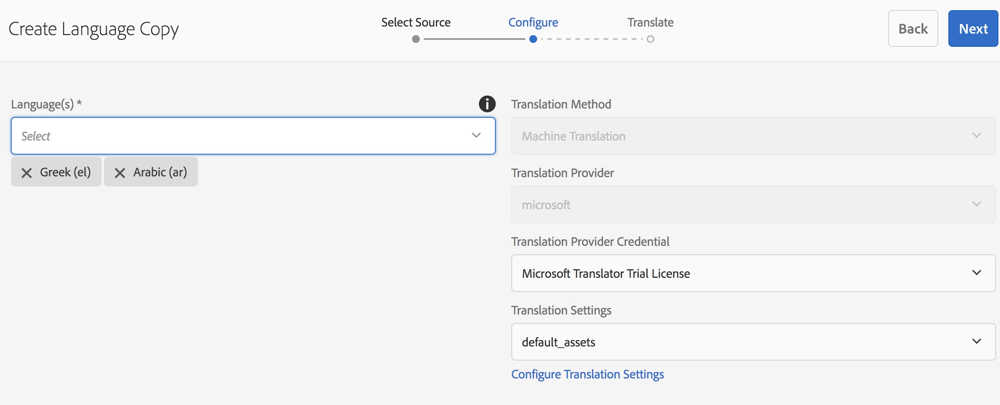
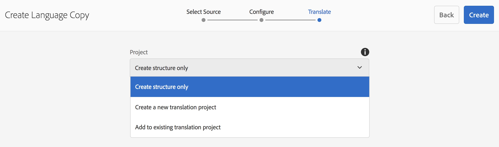
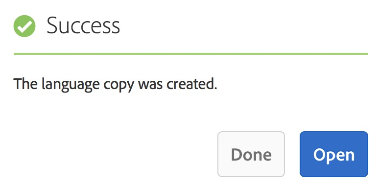

# Creazione guidata della copia per lingua{#language-copy-wizard}

La Creazione guidata copia in lingua è un’esperienza guidata per la creazione e la strumentazione di una struttura di contenuto multilingue. La creazione di una copia per lingua è ora molto più semplice e veloce.

>[!NOTE]
>
>Per creare la copia in lingua di un sito, l&#39;utente deve essere membro del gruppo amministratori dei progetti.

Per accedere a questa procedura guidata:

1. In Sites, seleziona una pagina e fai clic su Crea.

   

1. Seleziona Copia in lingua e viene visualizzata la procedura guidata.

   

1. Il passaggio **Seleziona Source** della procedura guidata consente di aggiungere/rimuovere pagine. È inoltre possibile includere o escludere le pagine secondarie.

   

1. Il pulsante **Avanti** ti porta al passaggio **Configura** della procedura guidata. Qui puoi aggiungere/rimuovere le lingue e selezionare il metodo di traduzione.

   

   >[!NOTE]
   >
   >Per impostazione predefinita, è disponibile una sola impostazione di traduzione. Per poter selezionare altre impostazioni, devi prima configurare le configurazioni cloud. Consulta [Configurazione del framework di integrazione della traduzione](/help/sites-administering/tc-tic.md).

1. Il pulsante **Avanti** consente di accedere al passaggio **Traduci** della procedura guidata. Qui puoi scegliere se creare solo la struttura, creare un progetto di traduzione o aggiungere elementi a un progetto di traduzione esistente.

   >[!NOTE]
   >
   >Se hai selezionato più lingue nel passaggio precedente, verranno creati più progetti di traduzione.

   

1. Il pulsante **Crea** termina la creazione guidata.

   
