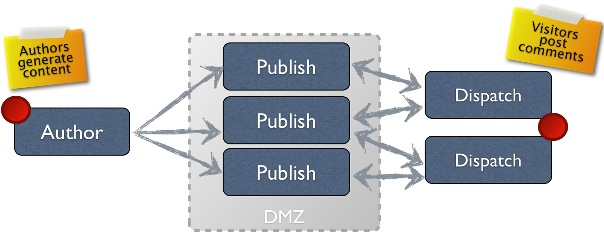

# Authoring{#authoring}

## Concetto di authoring (e pubblicazione) {#concept-of-authoring-and-publishing}

AEM offre due ambienti:

* Autore
* Pubblicazione

Questi interagiscono tra di loro e consentono di rendere i contenuti disponibili sul sito web, in modo che i visitatori possano leggerli.

L’ambiente di authoring fornisce le funzioni necessarie per creare, aggiornare e rivedere i contenuti prima che vengano pubblicati:

* Un autore crea e rivede il contenuto (che può essere di diversi tipi: pagine, risorse, pubblicazioni e così via)
* che, a un certo punto, sarà pubblicato sul tuo sito web.

Nell’ambiente di authoring, le funzionalità di AEM sono rese disponibili tramite due interfacce. Nell’ambiente di pubblicazione vengono invece progettati l’aspetto e il comportamento dell’interfaccia presentata agli utenti.

### Ambiente di authoring {#author-environment}

L’autore lavora in ciò che è noto come **ambiente di authoring**. Questo fornisce un’interfaccia di facile utilizzo (interfaccia grafica utente (GUI o UI)) per la creazione dei contenuti. Si trova dietro un firewall aziendale che fornisce protezione completa e richiede all’autore di accedere, utilizzando un account a cui sono stati assegnati i diritti di accesso appropriati.

>[!NOTE]
>
>Per creare, modificare o pubblicare contenuti, il tuo account deve disporre dei diritti di accesso appropriati.

A seconda della configurazione dell’istanza e dei diritti di accesso personali, puoi eseguire molte attività sul contenuto, tra cui (tra le altre):

* generare nuovo contenuto o modificare contenuto esistente in una pagina
* utilizzare modelli predefiniti per creare nuove pagine di contenuto
* creare, modificare e gestire risorse e raccolte
* creare, modificare e gestire le pubblicazioni
* sviluppare le campagne e le risorse correlate
* sviluppare e gestire siti community
* spostare, copiare o eliminare pagine di contenuto, risorse e così via
* pubblicare (o annullare la pubblicazione) pagine, risorse e così via

Sono anche disponibili attività amministrative per la gestione dei contenuti:

* flussi di lavoro che controllano il modo in cui vengono gestite le modifiche; ad esempio, imporre una revisione prima della pubblicazione
* progetti che coordinano singole attività

>[!NOTE]
>
>AEM è anche [amministrato](/help/sites-administering/home.md) (per la maggior parte delle attività) dall&#39;ambiente di authoring.

#### Ambiente di pubblicazione {#publish-environment}

Quando è pronto, il contenuto del sito AEM viene pubblicato nell&#39;**ambiente di pubblicazione**. Qui le pagine del sito web vengono rese disponibili al pubblico di destinazione in base all’aspetto dell’interfaccia progettata.

Di solito, l&#39;ambiente di pubblicazione si trova all&#39;interno della zona demilitarizzata; in altre parole, disponibile a Internet, ma non più sotto la piena protezione della rete interna.

Se il sito AEM è un [sito community](/help/communities/overview.md) o include [componenti community](/help/communities/author-communities.md), i visitatori del sito connessi (membri) possono interagire con le funzionalità delle community. Ad esempio, possono pubblicare in un forum, pubblicare un commento o seguire altri membri. Ai membri può essere concessa l&#39;autorizzazione ad eseguire attività normalmente limitate all&#39;ambiente di authoring, come creare nuove pagine (gruppi della community), articoli di blog e moderare i post di altri membri.

>[!NOTE]
>
>Sfortunatamente a volte c&#39;è una sovrapposizione nella terminologia utilizzata. Ciò può accadere con:
>
>* **Pubblica/Annulla pubblicazione**
>  Termini principali per le azioni che consentono di rendere o meno i contenuti disponibili al pubblico nell’ambiente di pubblicazione.
>
>* **Attiva/Disattiva**
>  Sinonimi di pubblicare/annullare la pubblicazione.
>
>* **Replica/Replica**
>  Questi sono i termini tecnici utilizzati per indicare lo spostamento di dati (ad esempio contenuto di una pagina, file, codice e commenti degli utenti) da un ambiente all’altro, ovvero durante la pubblicazione o la replica inversa di commenti degli utenti.
>

#### Dispatcher {#dispatcher}

Per ottimizzare le prestazioni per i visitatori del sito Web, **[Dispatcher](https://experienceleague.adobe.com/docs/experience-manager-dispatcher/using/dispatcher.html?lang=it)** implementa il bilanciamento del carico e la memorizzazione nella cache.
