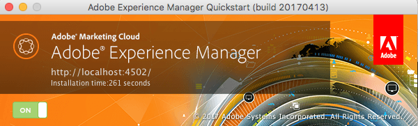

# Avvio e arresto dalla riga di comando{#command-line-start-and-stop}

## Avvio di Adobe Experience Manager dalla riga di comando {#starting-adobe-experience-manager-from-the-command-line}

Lo script `start` è disponibile nella directory *&lt;cq-installation>/bin*. Vengono fornite entrambe le versioni UNIX® e Windows. Lo script avvia l&#39;istanza installata nella directory *&lt;cq-installation>*.

Queste due versioni supportano un elenco di variabili di ambiente che possono essere utilizzate per avviare e regolare l’istanza Adobe Experience Manager (AEM).

<table>
 <tbody>
  <tr>
   <td><strong>Variabile di ambiente </strong></td>
   <td><strong>Descrizione </strong></td>
  </tr>
  <tr>
   <td>CQ_PORT</td>
   <td>Porta TCP utilizzata per gli script di stato e di arresto<br /> </td>
  </tr>
  <tr>
   <td>CQ_HOST</td>
   <td>Nome host<br /> </td>
  </tr>
  <tr>
   <td>CQ_INTERFACE</td>
   <td>Interfaccia a cui questo server deve essere in ascolto<br /> </td>
  </tr>
  <tr>
   <td>CQ_RUNMODE</td>
   <td>Modalità di esecuzione separate da virgola<br /> </td>
  </tr>
  <tr>
   <td>CQ_JARFILE</td>
   <td>Nome del file jar<br /> </td>
  </tr>
  <tr>
   <td>CQ_USE_JAAS</td>
   <td>Utilizzo di JAAS (se true)<br /> </td>
  </tr>
  <tr>
   <td>CQ_JAAS_CONFIG</td>
   <td>Percorso della configurazione JAAS<br /> </td>
  </tr>
  <tr>
   <td>CQ_JVM_OPTS</td>
   <td>Opzioni JVM predefinite<br /> </td>
  </tr>
 </tbody>
</table>

>[!CAUTION]
>
>Alcune modalità di esecuzione, tra cui authoring e pubblicazione, devono essere impostate prima di avviare AEM per la prima volta e non possono essere modificate successivamente. Prima di configurare un&#39;istanza di AEM utilizzata in produzione, vedere la [documentazione sulle modalità di esecuzione](/help/sites-deploying/configure-runmodes.md) per i dettagli.

### Esempio di script start.bat per piattaforma Windows {#windows-platform-start-bat-script-example}

```shell
SET CQ_PORT=1234 & ./start.bat
```

### Esempio di script per piattaforma UNIX® {#unix-platform-start-script-example}

```shell
CQ_PORT=1234 ./start
```

>[!NOTE]
>
>Lo script di avvio avvia AEM Quickstart installato nella cartella *&lt;cq-installation>/app*.

## Interruzione di Adobe Experience Manager {#stopping-adobe-experience-manager}

Per interrompere AEM, effettuare una delle seguenti operazioni:

* A seconda della piattaforma utilizzata:

  * Se AEM è stato avviato da uno script o dalla riga di comando, premere **Ctrl+C** per arrestare il server.
  * Se è stato utilizzato lo script di avvio in UNIX®, è necessario utilizzare lo script di arresto per arrestare AEM.

* Se hai avviato AEM facendo doppio clic sul file jar, fai clic sul pulsante **On** nella finestra di avvio (il pulsante diventa **Off**) per arrestare il server.

  

## Interruzione di Adobe Experience Manager dalla riga di comando {#stopping-adobe-experience-manager-from-the-command-line}

Lo script `stop` è disponibile nella directory *&lt;cq-installation>/bin*. Vengono fornite entrambe le versioni UNIX® e Windows. Lo script arresta l&#39;istanza in esecuzione installata nella directory *&lt;cq-installation>*.

### Esempio di script di arresto della piattaforma UNIX® {#unix-platform-stop-script-example}

```shell
./stop
```

### Esempio di script stop.bat della piattaforma Windows {#windows-platform-stop-bat-script-example}

```shell
./stop.bat
```

Se desideri solo preconfigurare l’archivio (senza riposizionarlo), devi solo:

* Estrai `repository.xml` nel percorso richiesto

* aggiorna `repository.xml` come richiesto

* crea `bootstrap.properties` e definisci `repository.config`

Di nuovo, prima di avviare l&#39;installazione effettiva.
