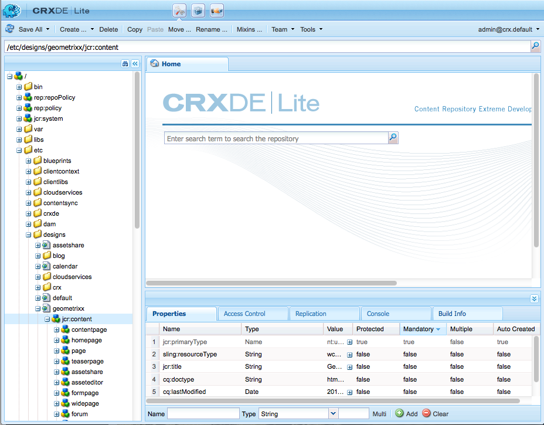

# Design e Designer{#designs-and-the-designer}

>[!CAUTION]
>
>Questo articolo descrive come creare un sito web basato sull’interfaccia classica. Adobe consiglia di utilizzare le tecnologie AEM più recenti per i siti Web, come descritto in dettaglio nell&#39;articolo [Guida introduttiva allo sviluppo di AEM Sites](/help/sites-developing/getting-started.md).

Designer consente di creare una progettazione per il sito Web utilizzando l&#39;[interfaccia utente classica](/help/release-notes/touch-ui-features-status.md) in AEM.

>[!NOTE]
>
>Per ulteriori informazioni sull&#39;accessibilità Web, vedere [AEM e le linee guida per l&#39;accessibilità Web](/help/managing/web-accessibility.md).

## Utilizzo di Designer {#using-the-designer}

La progettazione può essere definita nella sezione **progettazioni** della scheda **Strumenti**:


Qui puoi creare la struttura necessaria per memorizzare la progettazione, quindi caricare i fogli di stile CSS e le immagini richieste.

Le progettazioni sono archiviate in `/apps/<your-project>`. Il percorso della struttura da utilizzare per un sito Web è specificato utilizzando la proprietà `cq:designPath` del nodo `jcr:content`.



>[!NOTE]
>
>Tutte le modifiche apportate in una pagina in modalità progettazione vengono mantenute sotto il nodo di progettazione del sito e vengono applicate automaticamente a tutte le pagine con la stessa progettazione.

## Di cosa avrai bisogno {#what-you-will-need}

Per realizzare il tuo progetto avrai bisogno di:

**CSS** - I Cascading Style Sheets definiscono i formati di aree specifiche nelle pagine.
**Immagini** - Qualsiasi immagine utilizzata per funzioni quali sfondi e pulsanti.

### Considerazioni Durante La Progettazione Del Sito Web {#considerations-when-designing-your-website}

Durante lo sviluppo di un sito Web, si consiglia di memorizzare immagini e file CSS in `/apps/<your-project>` in modo da poter fare riferimento alle risorse in base alla progettazione corrente, come descritto dallo snippet seguente.

```xml
<%= currentDesign.getPath() + "/static/img/icon.gif %>
```

L’esempio precedente offre diversi vantaggi:

* I componenti possono avere un aspetto diverso in base a ciascun sito, utilizzando un percorso di progettazione diverso.
* È possibile riprogettare il sito Web semplicemente puntando il percorso di progettazione a un nodo diverso nella directory principale del sito da `design/v1` a `design/v2.`

* `/etc/designs` e `/content` sono gli unici URL esterni che il browser vede proteggendoti da un utente esterno che si incuriosisce di ciò che si trova nella struttura `/apps`. I vantaggi dell’URL di cui sopra consentono inoltre all’amministratore di sistema di impostare una maggiore sicurezza poiché si limita l’esposizione delle risorse a poche posizioni distinte.
