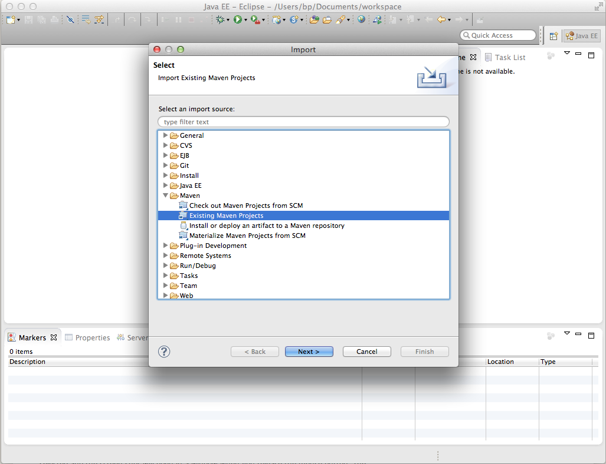

# Sviluppare progetti AEM con Eclipse{#how-to-develop-aem-projects-using-eclipse}

Questa guida descrive come utilizzare Eclipse per sviluppare progetti basati su AEM.

>[!NOTE]
>
>Adobe ora fornisce [Strumenti di sviluppo AEM per Eclipse](/help/sites-developing/aem-eclipse.md) che ti consente di sviluppare soluzioni AEM con Eclipse.

## Panoramica {#overview}

Per iniziare a sviluppare AEM su Eclipse, sono necessari i seguenti passaggi.

Ognuno di essi viene spiegato più dettagliatamente nel resto di questa procedura.

* Installare Eclipse 4.3 (Kepler)
* Configurare il progetto AEM basato su Maven
* Preparare il supporto JSP per Eclipse nel POM Maven
* Importare il progetto Maven in Eclipse

>[!NOTE]
>
>Questa guida si basa su Eclipse 4.3 (Kepler) e AEM 5.6.1.

## Installare Eclipse {#install-eclipse}

Scaricare l&#39;IDE Eclipse per sviluppatori Java EE dalla [pagina Download Eclipse](https://www.eclipse.org/downloads/).

Installa Eclipse seguendo le [istruzioni di installazione](https://wiki.eclipse.org/Eclipse/Installation).

## Configurare il progetto AEM basato su Maven {#set-up-your-aem-project-based-on-maven}

Quindi, configura il tuo progetto utilizzando Maven come descritto in [Come creare progetti AEM utilizzando Apache Maven](/help/sites-developing/ht-projects-maven.md).

## Preparare il supporto JSP per Eclipse {#prepare-jsp-support-for-eclipse}

Eclipse può anche fornire supporto nell’utilizzo di JSP, ad esempio,

* completamento automatico delle librerie di tag
* Eclipse-awareness degli oggetti definiti da &lt;cq:defineObjects /> e &lt;sling:defineObjects />

Perché ciò funzioni:

1. Segui le istruzioni in [Come lavorare con JSP](/help/sites-developing/ht-projects-maven.md#how-to-work-with-jsps) in [Come creare progetti AEM utilizzando Apache Maven](/help/sites-developing/ht-projects-maven.md).
1. Aggiungi quanto segue alla sezione &lt;build /> del POM del modulo di contenuto.

   Il plug-in di supporto Maven di Eclipse, m2e, non fornisce il supporto per maven-jspc-plugin, e questa configurazione dice a m2e di ignorare il plug-in e l’attività correlata di pulizia dei risultati della compilazione temporanea.

   Questo non è un problema: come indicato in [Come utilizzare i JSP](/help/sites-developing/ht-projects-maven.md#how-to-work-with-jsps), il maven-jspc-plugin di questa configurazione viene utilizzato solo per convalidare la compilazione dei JSP come parte del processo di compilazione. Eclipse segnala già qualsiasi problema nei JSP e non si basa su questo plug-in Maven per poterlo fare.

   **myproject/content/pom.xml**

   ```xml
   <build>
     <!-- ... -->
     <pluginManagement>
       <plugins>
         <!--This plugin's configuration is used to store Eclipse m2e settings only. It has no influence on the Maven build itself.-->
         <plugin>
           <groupId>org.eclipse.m2e</groupId>
           <artifactId>lifecycle-mapping</artifactId>
           <version>1.0.0</version>
           <configuration>
             <lifecycleMappingMetadata>
               <pluginExecutions>
                 <pluginExecution>
                   <pluginExecutionFilter>
                     <groupId>org.apache.sling</groupId>
                     <artifactId>maven-jspc-plugin</artifactId>
                     <versionRange>[2.0.6,)</versionRange>
                     <goals>
                       <goal>jspc</goal>
                     </goals>
                   </pluginExecutionFilter>
                   <action>
                     <ignore/>
                   </action>
                 </pluginExecution>
                 <pluginExecution>
                   <pluginExecutionFilter>
                     <groupId>org.apache.maven.plugins</groupId>
                     <artifactId>maven-clean-plugin</artifactId>
                     <versionRange>[2.4.1,)</versionRange>
                     <goals>
                       <goal>clean</goal>
                     </goals>
                   </pluginExecutionFilter>
                   <action>
                     <ignore/>
                   </action>
                 </pluginExecution>
               </pluginExecutions>
             </lifecycleMappingMetadata>
           </configuration>
         </plugin>
       </plugins>
     </pluginManagement>
   </build>
   ```

### Importare il progetto Maven in Eclipse {#import-the-maven-project-into-eclipse}

1. In Eclipse, scegliete File > Importa...
1. Nella finestra di dialogo Importa, scegli Maven > Progetti Maven esistenti, quindi fai clic su &quot;Successivo&quot;.

   

1. Inserisci il percorso della cartella principale del progetto, quindi fai clic su &quot;Seleziona tutto&quot; e &quot;Fine&quot;.

   

1. Ora è tutto pronto per utilizzare Eclipse per sviluppare il progetto AEM, incluso il completamento automatico JSP.

   

   >[!NOTE]
   >
   >Se includi `/libs/foundation/global.jsp` o altre JSP in `/libs`, devi copiarle nel progetto in modo che Eclipse possa risolvere l&#39;inclusione. Allo stesso tempo, devi accertarti che non sia incluso nel pacchetto di contenuti da Maven. Per ottenere questo risultato, consulta [Come creare progetti AEM utilizzando Apache Maven](/help/sites-developing/ht-projects-maven.md).
