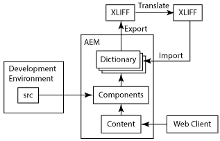
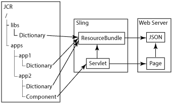

# Internazionalizzazione dei componenti{#internationalizing-components}

Internazionalizza i componenti e le finestre di dialogo in modo che le relative stringhe dell’interfaccia utente possano essere presentate in lingue diverse. I componenti progettati per l’internazionalizzazione consentono di esternalizzare, tradurre e importare le stringhe dell’interfaccia utente nell’archivio. In fase di esecuzione, le preferenze della lingua dell’utente o le impostazioni locali della pagina determinano quale lingua viene visualizzata nell’interfaccia utente.

Utilizza il seguente processo per internazionalizzare i componenti e fornire l’interfaccia utente in diverse lingue:

1. [Implementare i componenti utilizzando codice che internazionalizza le stringhe.](/help/sites-developing/i18n-dev.md) Il codice identifica le stringhe da tradurre e seleziona la lingua da presentare in fase di esecuzione.
1. [Crea dizionari](/help/sites-developing/i18n-translator.md#creating-a-dictionary) e [aggiungi](/help/sites-developing/i18n-translator.md#adding-changing-and-removing-strings) le stringhe inglesi da tradurre.

1. [Esporta](/help/sites-developing/i18n-translator.md#exporting-a-dictionary) il dizionario in formato XLIFF, traduci le stringhe, quindi [importa](/help/sites-developing/i18n-translator.md#importing-a-dictionary) di nuovo i file XLIFF in AEM. In alternativa, è possibile [aggiungere manualmente le traduzioni](/help/sites-developing/i18n-translator.md#editing-translated-strings) al dizionario.

1. [Incorporare il dizionario nel processo di gestione delle versioni dell&#39;applicazione](/help/sites-developing/i18n-translator.md#publishing-dictionaries).

>[!NOTE]
>
>I metodi qui descritti per l’internazionalizzazione dei componenti sono destinati alla traduzione di stringhe statiche. Quando ci si aspetta che le stringhe dei componenti cambino, è necessario utilizzare i flussi di lavoro di traduzione convenzionali. Ad esempio, se gli autori possono modificare una stringa dell’interfaccia utente utilizzando le proprietà nella finestra di dialogo Modifica di un componente, non utilizzare un dizionario della lingua per internazionalizzare la stringa.

## Dizionari di lingua {#language-dictionaries}

Il framework di internazionalizzazione di AEM utilizza i dizionari nell’archivio per memorizzare le stringhe in inglese e le relative traduzioni in altre lingue. Il framework utilizza l&#39;inglese come lingua predefinita. Le stringhe vengono identificate utilizzando la loro versione inglese. In genere, i framework di internazionalizzazione utilizzano ID alfanumerici per le stringhe dell’interfaccia utente. L’utilizzo della versione inglese della stringa come ID presenta diversi vantaggi:

* Il codice è facile da leggere.
* La lingua predefinita è sempre disponibile.

Le stringhe localizzate possono essere memorizzate in diversi dizionari dell&#39;archivio. I dizionari di sistema di AEM si trovano sotto il nodo `/libs`. È possibile creare dizionari per i componenti sotto il nodo `/apps`. Il framework di internazionalizzazione di AEM combina i dizionari e li rende disponibili in Sling come un singolo oggetto `ResourceBundle`. Quando i componenti vengono sottoposti a rendering, recuperano le stringhe tradotte dal bundle di risorse. I dizionari combinati vengono distribuiti anche sul server web in formato JSON per fornire stringhe tradotte al codice JavaScript nelle pagine web.

Inoltre, lo [strumento di traduzione](/help/sites-developing/i18n-translator.md) consente di gestire tutti i dizionari da un&#39;unica posizione centrale.

>[!NOTE]
>
>Non modificare i dizionari di sistema di AEM che si trovano sotto il nodo `/libs`.

### Sovrapposizione di stringhe nei dizionari di sistema {#overlaying-strings-in-system-dictionaries}

Le stringhe nei dizionari al di sotto del nodo `/apps` sostituiscono le stringhe duplicate nei dizionari al di sotto del nodo `/libs`. Se i componenti utilizzano stringhe incluse nei dizionari di sistema di AEM, duplicare la stringa nel proprio dizionario. Tutti i componenti utilizzeranno le stringhe del dizionario.

Non è possibile prevedere quale traduzione viene utilizzata quando le stringhe vengono duplicate nei dizionari che si trovano tutti sotto il nodo `/apps`.
