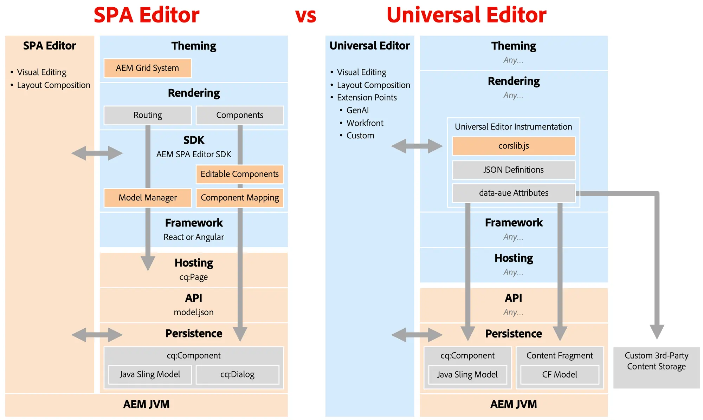

# Rimozione dell’editor di SPA {#spa-editor-deprecation}

Anche se l’editor di applicazioni a pagina singola rimane supportato da Adobe, scopri cosa significa la sua rimozione dal progetto e quali opzioni hai per i progetti futuri.

## Riepilogo {#summary}

Adobe ha dichiarato obsoleto l&#39;editor SPA con [versione 6.5.23 di AEM 6.5,](/help/release-notes/release-notes.md#spa-editor), il che significa che non verranno apportati ulteriori miglioramenti o aggiornamenti ai relativi SDK. Adobe ti incoraggia a utilizzare [Universal Editor](/help/sites-developing/universal-editor/introduction.md) per qualsiasi nuovo progetto headless, al fine di sfruttare le ultime innovazioni di AEM.

## Dettagli dell’obsolescenza {#details}

La rimozione dell&#39;editor di applicazioni a pagina singola **non implica la rimozione immediata**. Se sono presenti implementazioni esistenti, **è possibile continuare a utilizzarlo finché soddisfa le proprie esigenze.** Tuttavia, tieni presente le seguenti implicazioni relative alla sua rimozione.

* In futuro, Adobe si occuperà solo dei problemi P1 e P2 e delle vulnerabilità di sicurezza.
* Non verranno apportati ulteriori sviluppi, miglioramenti o aggiornamenti ai relativi SDK.

I seguenti SDK sono ora in fase di blocco delle funzioni.

* [Archetipo di progetto AEM](https://github.com/adobe/aem-project-archetype/)
* [Core del progetto SPA di AEM](https://github.com/adobe/aem-spa-project-core)
* [Gestione modelli pagina SPA di AEM](https://github.com/adobe/aem-spa-page-model-manager)
* [Mappatura dei componenti SPA di AEM](https://github.com/adobe/aem-spa-component-mapping)
* [Componenti modificabili di AEM SPA React](https://github.com/adobe/aem-react-editable-components)
  * [Componenti core React di AEM](https://github.com/adobe/aem-react-core-wcm-components)
  * [Base dei componenti core React di AEM](https://github.com/adobe/aem-react-core-wcm-components-base)
  * [SPA dei componenti core React di AEM](https://github.com/adobe/aem-react-core-wcm-components-spa)
  * [Esempi di componenti core React di AEM](https://github.com/adobe/aem-react-core-wcm-components-examples)
* [Componenti modificabili di AEM SPA Angular](https://github.com/adobe/aem-angular-editable-components)
  * [Componenti core di AEM Angular](https://github.com/adobe/aem-angular-core-wcm-components)
  * [Base dei componenti core di AEM Angular](https://github.com/adobe/aem-angular-core-wcm-components-base)
  * [Componenti core SPA di AEM Angular](https://github.com/adobe/aem-angular-core-wcm-components-spa)
  * [Esempi di componenti core di AEM Angular](https://github.com/adobe/aem-angular-core-wcm-components-examples)
* [Componenti modificabili di AEM SPA Vue](https://github.com/mavicellc/aem-vue-editable-components)

## Alternative all’editor SPA {#alternatives}

La sostituzione più adatta per l’editor SPA dipende dalle esigenze dei tuoi progetti.

* **[L&#39;editor universale](/help/sites-developing/universal-editor/introduction.md)** è la sostituzione diretta migliore per l&#39;editor SPA.
  * Universal Editor è anche un editor visivo ed è stato progettato appositamente per implementazioni disaccoppiate, incorporando tutta l’esperienza di Adobe dall’editor SPA.
  * L&#39;editor universale è stato anche [rilasciato per AEM as a Cloud Service](https://experienceleague.adobe.com/it/docs/experience-manager-cloud-service/content/implementing/developing/universal-editor/introduction) e pertanto supporta casi d&#39;uso AMS e on-prem oltre a Cloud Services.
* **[L&#39;Editor frammento di contenuto](/help/sites-developing/universal-editor/introduction.md)** è un&#39;alternativa per coloro che preferiscono un editor basato su moduli.
  * L’Editor frammenti di contenuto è ideale quando il contenuto è strutturato come frammenti di contenuto anziché come pagine.

La strutturazione dei contenuti con Frammenti di contenuto non esclude l’utilizzo dell’Editor universale come editor visivo ed entrambi gli editor possono essere utilizzati insieme.

## Eseguire la migrazione all’editor universale {#migrate-ue}

L&#39;editor universale offre molti vantaggi, rendendo la migrazione ad esso un&#39;ottima soluzione per nuovi progetti.

* **Modifica visiva:** Come per l&#39;editor SPA, gli autori possono modificare il contenuto direttamente nell&#39;anteprima e vedere immediatamente come le loro modifiche influiscono sull&#39;esperienza del visitatore.
* **A prova di futuro:** la roadmap di AEM dà priorità all’editor universale come editor grafico. Il suo utilizzo garantisce l’accesso alle innovazioni e ai miglioramenti più recenti.
* **Integrazione semplificata:** non è necessario alcun SDK specifico per AEM per utilizzare l’editor universale, così si riduce il blocco dello stack tecnologico.
* **Porta la tua app:** l’editor universale supporta qualsiasi framework o architettura web, consentendo l’utilizzo senza richiedere un refactoring complesso.
* **Estensibilità:** l’editor universale dispone di un solido [framework di estensione](https://experienceleague.adobe.com/en/docs/experience-manager-cloud-service/content/implementing/developing/universal-editor/extending), che include integrazioni con GenAI, Workfront e altro ancora.

Non esiste un percorso di migrazione diretta dall’editor SPA all’editor universale. Ciò è dovuto a differenze fondamentali nelle due tecnologie.

* L’editor universale non reintroduce funzioni quali Editor modelli, Sistema di stili o Griglia reattiva.
  * Questi casi d’uso possono ora essere gestiti in modo più efficiente con CSS e JS front-end snella in Edge Delivery Services o progetti headless.
* Poiché l’editor universale è un editor come servizio, non può consentire agli implementatori di inserire CSS o JS nelle finestre di dialogo dei componenti.
  * In tal modo si impedisce la conversione automatica delle finestre di dialogo dei componenti dall’editor pagina.
  * Questo interessa molte aree delle finestre di dialogo, come i widget personalizzati, la convalida dei campi, le regole mostra/nascondi e le personalizzazioni basate su modelli.

Tenendo presenti queste differenze tecniche, Adobe consiglia di:

* Mantenere invariati i siti editor SPA esistenti poiché il supporto continua.
* Adottare l&#39;Editor universale per tutti i nuovi sviluppi, inclusi i nuovi siti, sezioni o pagine.

Tieni presente che, anche se non vi è alcuna implementazione diretta di alcune funzioni dell’Editor SPA nell’Editor universale, esistono nuovi modi per risolvere gli stessi problemi utilizzando la nuova flessibilità dell’Editor universale.

## Confronto tra l’Editor SPA e l’Editor universale {#spa-vs-ue}

L’editor universale offre molta più libertà agli implementatori di app web, come illustrato in questo diagramma.

|  | Editor di SPA | Editor universale |
|---|---|---|
| **Tema** | L’app deve implementare il layout con il CSS griglia di AEM. | L’app può utilizzare qualsiasi tecnica CSS moderna per il layout. |
| **Rendering** | L’app deve seguire la struttura di indirizzamento dell’editor di applicazioni a pagina singola. | L’app può essere implementata liberamente, senza regole o pattern imposti da seguire. |
| **SDK** | L’implementazione deve integrare strettamente SDK. | Sul livello di authoring, l&#39;app carica semplicemente `corlib.js` e fornisce istruzioni all&#39;editor universale tramite le annotazioni di HTML. |
| **Framework** | L’app deve utilizzare una versione supportata di React o Angular. | L’app può utilizzare qualsiasi framework o architettura. |
| **Hosting** | L&#39;app deve essere ospitata nel dominio di AEM. | L’app può essere completamente scollegata e ospitata ovunque. |
| **API** | L&#39;app deve recuperare il contenuto dall&#39;API `model.json`. | L’app può utilizzare qualsiasi API, comprese quelle personalizzate. |
| **Persistenza** | L’editor SPA supporta solo il contenuto della pagina per la modifica visiva. | Universal Editor supporta in modo nativo la modifica visiva di pagine e frammenti di contenuto. |
|  |  | L’editor universale può essere esteso per modificare contenuti esterni con le stesse funzionalità visive. |
|  | Gli sviluppatori devono distribuire modelli Sling e `cq:Dialog` in AEM. | Gli sviluppatori hanno bisogno di poca o nessuna esperienza con AEM e non hanno bisogno di scrivere alcun Java. |
