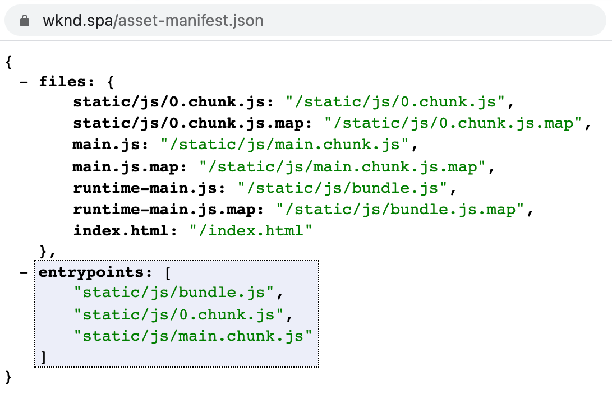

# Componente RemotePage {#remote-page-component}

Quando decidi quale livello di integrazione desideri avere tra l’applicazione a pagina singola esterna e AEM, spesso è chiaro che devi essere in grado di visualizzare e modificare l’applicazione a pagina singola in AEM. Il componente RemotePage è un componente pagina personalizzato appositamente per questo scopo.

{{ue-over-spa}}

## Panoramica {#overview}

Il componente RemotePage recupera tutte le risorse necessarie da `asset-manifest.json` generato dall&#39;applicazione e lo utilizza per il rendering dell&#39;applicazione a pagina singola in AEM.

* RemotePage consente di inserire gli script e i fogli di stile di un’applicazione a pagina singola nel corpo di un componente AEM Page.
* I componenti front-end virtuali consentono di contrassegnare le sezioni come modificabili nell’editor SPA di AEM.
* Insieme, un’applicazione a pagina singola ospitata su un dominio diverso può essere resa modificabile in AEM.

Consulta l&#39;articolo [Modifica di un&#39;applicazione a pagina singola esterna all&#39;interno di AEM](spa-edit-external.md) per ulteriori dettagli sulle applicazioni a pagina singola esterne modificabili in AEM.

## Requisiti {#requirements}

* Abilitare CORS nello sviluppo
* Configurare l’URL remoto nelle Proprietà pagina
* Eseguire il rendering dell’applicazione a pagina singola in AEM
* L’applicazione web deve utilizzare un manifesto della risorsa bundler come uno dei seguenti ed esporre un file asset-manifest.json nella directory principale del dominio che elenca in una proprietà entrypoints tutti i file CSS e JS da caricare:
  * https://github.com/shellscape/webpack-manifest-plugin
  * https://github.com/webdeveric/webpack-assets-manifest
  * https://github.com/mugi-uno/parcel-plugin-bundle-manifest

  

* L&#39;applicazione deve essere in grado di inizializzare in un `

` sotto l&#39;elemento body. Se è previsto un markup diverso per la creazione dell&#39;istanza dell&#39;app, è necessario regolarlo di conseguenza negli script HTL del componente proxy con `sling:resourceSuperType="spa-project-core/components/remotepage`.

## Limitazioni {#limitations}

* Il componente RemotePage prevede che l&#39;implementazione fornisca un manifesto di risorse come quello [trovato qui.](https://github.com/shellscape/webpack-manifest-plugin) Il componente RemotePage, tuttavia, è stato testato per funzionare solo con il framework React (e Next.js tramite il componente remote-page-next ) e pertanto non supporta il caricamento remoto di applicazioni da altri framework, come Angular.
* I CSS interni definiti nel file HTML principale dell’applicazione e i CSS in linea sul nodo DOM principale non saranno disponibili durante il rendering remoto in AEM.

## Dettagli tecnici {#technical-details}

Come il resto del progetto SPA di AEM, il componente RemotePage è open source. Per informazioni tecniche complete sul componente RemotePage, [consulta l&#39;archivio GitHub.](https://github.com/adobe/aem-spa-project-core/tree/master/ui.apps/src/main/content/jcr_root/apps/spa-project-core/components/remotepage)
