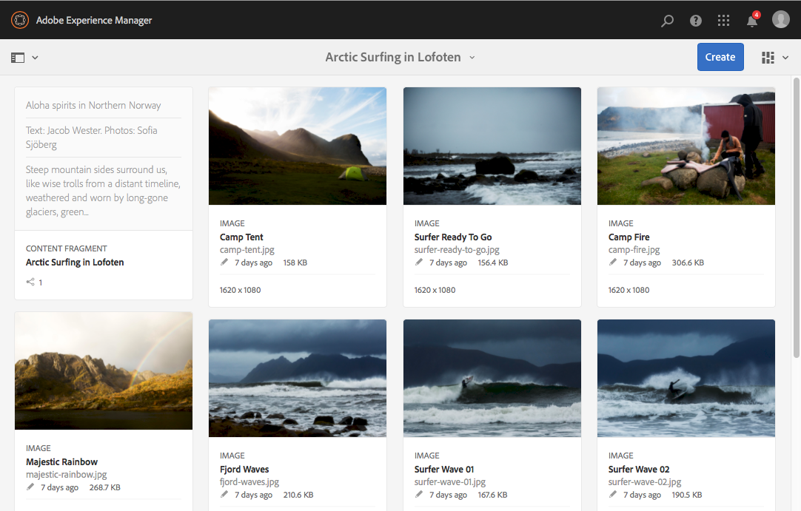

# Prova dei frammenti di contenuto in We.Retail{#trying-out-content-fragments-in-we-retail}

I frammenti di contenuto consentono di creare contenuti indipendenti dal canale, con possibili varianti per canali specifici. **We.Retail** (come disponibile in un&#39;istanza predefinita di Adobe Experience Manager) fornisce il frammento **Arctic Surfing in Lofoten** come esempio di base. Questo mostra che:

* I frammenti di contenuto di Adobe Experience Manager (AEM) vengono [creati e gestiti come risorse indipendenti dalla pagina](/help/assets/content-fragments/content-fragments.md). Consentono di creare contenuti indipendenti dal canale, con possibili varianti per canali specifici.

  * Vedi [Dove trovare le risorse dei frammenti di contenuto in We.Retail](#where-to-find-content-fragments-in-we-retail)

* Potrai quindi [utilizzare questi frammenti e le relative varianti durante l&#39;authoring](/help/sites-authoring/content-fragments.md) delle pagine di contenuto.

  * Vedi [Dove vengono utilizzati i frammenti di contenuto in We.Retail](#where-content-fragments-are-used-in-we-retail)

Per la documentazione completa sulla creazione, la gestione, l’utilizzo e lo sviluppo di frammenti di contenuto:

* Vedi [Ulteriori informazioni](#further-information)

>[!NOTE]
>
>I **frammenti di contenuto** e i **[frammenti di esperienza](/help/sites-authoring/experience-fragments.md)** sono funzioni diverse in AEM:
>
>* **I frammenti di contenuto** sono contenuti editoriali, principalmente testo e immagini correlate. Sono contenuti puri, senza design e layout.
>* I **frammenti di esperienza** sono contenuti completi di layout, frammenti di una pagina web.
>
>I frammenti esperienza possono includere contenuti sotto forma di frammenti di contenuto, ma non viceversa.

## Dove trovare i frammenti di contenuto in We.Retail {#where-to-find-content-fragments-in-we-retail}

In We.Retail sono presenti diversi frammenti di contenuto di esempio; naviga tramite **Assets**, **Files**, **We.Retail**, **English**, **Experiences**.

Tra questi, **Arctic Surfing in Lofoten**, un frammento con le relative risorse visive:

* Naviga tramite **Assets**, **Files**, **We.Retail**, **English**, **Experiences**, **Arctic Surfing in Lofoten**:

  * [http://localhost:4502/assets.html/content/dam/we-retail/en/experiences/arctic-surfing-in-lofoten](http://localhost:4502/assets.html/content/dam/we-retail/en/experiences/arctic-surfing-in-lofoten)

Puoi selezionare e modificare il frammento **Arctic Surfing in Lofoten**:

* [http://localhost:4502/editor.html/content/dam/we-retail/en/experiences/arctic-surfing-in-lofoten/arctic-surfing-in-lofoten](http://localhost:4502/editor.html/content/dam/we-retail/en/experiences/arctic-surfing-in-lofoten/arctic-surfing-in-lofoten)

Qui puoi [modificare e gestire](/help/assets/content-fragments/content-fragments.md) il frammento utilizzando le schede (pannello a sinistra):

<!--  ASSET does not exist-->

* **[Varianti](/help/assets/content-fragments/content-fragments-variations.md)** incluso [Markdown](/help/assets/content-fragments/content-fragments-markdown.md)
* **[Contenuto associato](/help/assets/content-fragments/content-fragments-assoc-content.md)**
* **[Metadati](/help/assets/content-fragments/content-fragments-metadata.md)**

## Dove vengono utilizzati i frammenti di contenuto in We.Retail {#where-content-fragments-are-used-in-we-retail}

Per illustrare l&#39;authoring di [pagine con un frammento di contenuto](/help/sites-authoring/content-fragments.md) sono disponibili diverse pagine di esempio in, ad esempio:

* [http://localhost:4502/sites.html/content/we-retail/language-masters/en/experience](http://localhost:4502/sites.html/content/we-retail/language-masters/en/experience)

Ad esempio, nel frammento di contenuto **Arctic Surfing in Lofoten** è presente un riferimento nella pagina Sites:

* Naviga tramite **Sites**, **We.Retail**, **Language Masters**, **English**, **Experience**. Quindi apri **Arctic Surfing in Lofoten** per la modifica:

  * [http://localhost:4502/editor.html/content/we-retail/language-masters/en/experience/arctic-surfing-in-lofoten.html](http://localhost:4502/editor.html/content/we-retail/language-masters/en/experience/arctic-surfing-in-lofoten.html)

## Ulteriori informazioni {#further-information}

Per ulteriori dettagli, consulta:

* [Utilizzo di frammenti di contenuto](/help/assets/content-fragments/content-fragments.md)

  * Scopri come creare, modificare e gestire le risorse dei frammenti di contenuto.

* [Authoring delle pagine con frammenti di contenuto](/help/sites-authoring/content-fragments.md)

  * Utilizza il frammento di contenuto quando crei una pagina.

* [Sviluppo di AEM: componenti per frammenti di contenuto](/help/sites-developing/components-content-fragments.md)

  * Panoramica dei componenti dei frammenti di contenuto.

* [Sviluppo ed estensione di frammenti di contenuto](/help/sites-developing/customizing-content-fragments.md)

  * Informazioni utili per sviluppare ed estendere frammenti di contenuto.
